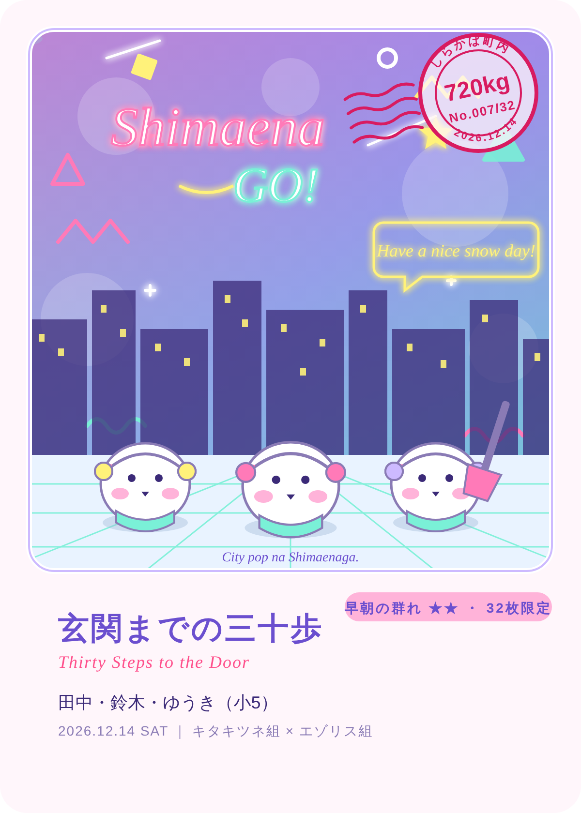

# シマエナGO

**寒い冬は、くっついて乗り切る。**

雪の朝に LINE で点呼が届き、町内のランダム3チームが、ひとり暮らしの家の雪をどける。
参加するほど、その朝だけのカードが増えていく雪かきゲームです。

Built with Claude: Japan 2026（Anthropic × Cerebral Valley 主催）提出作品。
**11月2日〜11月8日の期間中に、このリポジトリ上でゼロから制作しています。**



## 公開中のアプリ
- https://yukikaki-karano-kaihou.vercel.app/ （あそびかた `/rules`・地図 `/map`・デモ操作 `/admin`）

## デモ動画
（3分・日本語。提出時に URL を記入）

## 誰の、どんな課題を、どう解決するか
- **誰の**: 札幌の一軒家にひとりで暮らす高齢者。雪の朝、玄関から道路まで出られない。
- **どんな課題**: 近所に頼みたくても頼みにくい。手伝える人がいても、誰がどこで困っているか分からない。雪かきは早朝の重労働で、「ありがとう」だけでは人が集まらない。
- **どう解決するか**: 雪の朝に LINE で1問だけの点呼。「いいえ」の1タップで、Claude が近所のチームに5分単位の小さな仕事として割り振る。地図が塗られていき、動いた人にはその朝だけのカードが届く。

## 仕組み
詳しくは [`docs/spec.md`](docs/spec.md)。

## 技術
- Next.js（App Router）/ TypeScript / Tailwind CSS / Vercel / Neon（Postgres）
- Claude API（レベル判定・司令官・写真確認・カード生成・週末の実況）
- LINE Messaging API ＋ LIFF
- Leaflet ＋ OpenStreetMap、Open-Meteo

## Claude Code をどう使ったか
（制作後に記入。スマホから Claude Code に指示するだけで開発しています）

## 開発の記録
- 日々の記録: [`docs/devlog.md`](docs/devlog.md)
- 作業の順番: [`docs/tasks.md`](docs/tasks.md)
- 検討して見送った案: [`docs/plan-b-nuisho.md`](docs/plan-b-nuisho.md) ほか

## ローカルで動かす
```bash
npm install
npm run dev
```
`.env.local` に `ANTHROPIC_API_KEY` などを置きます（リポジトリには含めません）。
鍵がない間は、Claude はモック応答、保存はメモリで動きます。

## 公開版（Vercel）の準備
1. Vercel の環境変数に `DATABASE_URL`（Neon）を入れる。
2. `/admin` を開き「DB を準備する」を押す（表を作り、架空の町内データを入れる。何度押しても安全）。
3. 「保存: Neon（参加者 12 人）」と出れば完了。以後、地図とデモ操作の状態は Neon に保存される。
4. 表が増えたとき（`db/schema.sql` が変わったとき）は、`/admin` にまた黄色い枠が出るので、もう一度押す。

### LINE をつなぐ
1. Vercel の環境変数に `LINE_CHANNEL_SECRET`・`LINE_CHANNEL_ACCESS_TOKEN`・`NEXT_PUBLIC_LIFF_ID` を入れる。
2. LINE Developers の Messaging API チャネルで、Webhook URL を `https://yukikaki-karano-kaihou.vercel.app/api/line/webhook` にして「検証」→「Webhook の利用」をオン。
3. LINE Official Account Manager の「応答設定」で、あいさつメッセージ・応答メッセージをオフ（オンのままだと LINE 側の定型文も届く）。
4. 公式アカウントを友だち追加すると、「どちらですか？」から登録が始まる（役割 → 位置情報 → 2問）。家族は「家族の代わりに登録」→ 6桁の連携コードで本人や他の家族を紐づける。

### 朝の一本道（行く → 写真 → 完了）
- 作戦の LINE には「行く」「今朝は行けない」のボタンが付く。現地で終わったら、玄関前から道路側を写した写真を1枚 LINE に送ると、Claude が確認して完了になり、得点が入り、依頼者に「終わりました」が届く。
- 地図（LIFF のエンドポイントは `/map`）を LINE から開くと、ログインした本人の割り当てが出て、下の「行く」「終わりました（写真）」「人手が足りない」が使える。LINE の外では `/map?as=h3` のように架空の人として動かせる（デモ用）。

### ヘルプ通知と見守り
- 人手が足りない家（作戦の時点で不足／現場の「人手が足りない」／作戦のあとの「いいえ」）は、近い順に 300m → 600m → 1km の手伝う側（全チーム）に「5分でもOK」の小タスクを添えて LINE で呼びかける。5分おきに輪を広げ、最後は町内会役員役のサポーター（環境変数 `SUPPORTER_LINE_USER_IDS`、カンマ区切り）へ。
- 点呼に返事がない家は地図で灰色に点滅し、300m 以内の人に「声かけお願い」、家族に「返事がありません」が届く。体調や医療の判断はしない。
- 家が終わると、依頼者と家族に「終わりました」が届く。

### ありがとうカード
- 家が完了すると、来た人の数だけカードが発行され、LINE に表と裏の2枚が届く。二度と同じカードは発行されない（通し番号 No.○/○）。
- 絵は画像生成AIではなく `lib/cards/svg.ts` が図形から組み立てる。基本はかわいいシティポップ、7:30 までの完了で 80s レトロウェーブ、20cm 以上で切り絵、2チーム混成で湾岸ポップ、5日連続でドット絵。並ぶシマエナガの数＝来た人数、耳あて＝その人のチーム色、右上に消印（町内名・排雪kg・番号・日付）。
- デザイン名・英語副題・排雪量と身近な換算は Claude がつける（キーがない間は定型）。
- カード帳は `/cards`（LINE から開くと自分のぶん。デモは `/cards?as=h3`）。正方形（Instagram）と 4:5（X）で保存できる。PNG 化は resvg と同梱フォント（Zen Maru Gothic、OFL）。

### 日曜の「今週の群れ」とメニュー
- 日曜の夜（21:00 の cron、または `/admin` の「6」）に、今週の実況（Claude、キーなしは定型）・チーム順位・称号（3日で「早起きのエナガ」、5日で「朝の群れの主」＋レアカード確定）・週の目標ボーナス（関わった家が全部 8:00 までならチーム全員 +20）を LINE で送り、翌週のチームを出撃回数と体力でバランスよく組み直す。家族には「今週は N 回手伝ってもらいました」。
- LINE のリッチメニュー（地図／カード帳／いまからやる／あそびかた／設定）は `/admin` の「リッチメニューを作る」で作る（画像は SVG から）。LIFF のエンドポイント URL は公開 URL のルート（`https://yukikaki-karano-kaihou.vercel.app/`）にすると、`/map` と `/cards` が LINE の中で開く。
- 「いまからやる」→ 5／15／30分 を選ぶと、近く（1km 以内）の人手不足の家の小タスクか、作業中の家の偵察を1件提案する。

### 点呼を自動で動かす（Vercel Cron）
1. Vercel の環境変数に `CRON_SECRET`（長いランダムな文字列）を入れる。ないと `/api/cron/*` は動かない。
2. `vercel.json` の cron が、前夜 21:00 JST に予告（Open-Meteo で翌朝 6:00 までの降雪が 5cm 以上のときだけ。日曜は先に「今週の群れ」）、6:30 JST に点呼を送る。
3. 6:40 の作戦配信は Hobby プラン（cron は1日1回・2本まで）では cron に置いていない。6:40 以降に点呼の答えが届いたとき自動で配信される。Pro なら `vercel.json` に `{ "path": "/api/cron/plan", "schedule": "40 21 * * *" }` を足す。
4. 同じことは `/admin` のボタンで手動でもできる（デモはこちら）。

## データの出典
- 地図と建物の形: © [OpenStreetMap](https://www.openstreetmap.org/copyright) contributors（ODbL）
- 天気: [Open-Meteo](https://open-meteo.com/)
- デモの町内「しらかば町内」と登場人物は架空です。建物の形だけを OpenStreetMap から借りています（`scripts/build-town.cjs`）。

## ルールの遵守
- 期間中の新規制作のみ。既存コードの流用はありません。
- デモ用データはすべて架空の人物・場所です。
