<div align="center">


# シマエナGO

### 寒い冬は、くっついて乗り切る。

**雪の朝、ご近所どうしで「10分だけ」雪かきを助け合う、スマホのゲームです。**<br>
雪かきは入口。めざすのは、町から「ひとり」をなくすこと。

<br>

<a href="https://shimaena-go.vercel.app/"></a>
&nbsp;
<a href="https://youtu.be/vmgeT3S4i68"></a>
&nbsp;
<a href="#-一緒に作りませんか"></a>

<br><br>

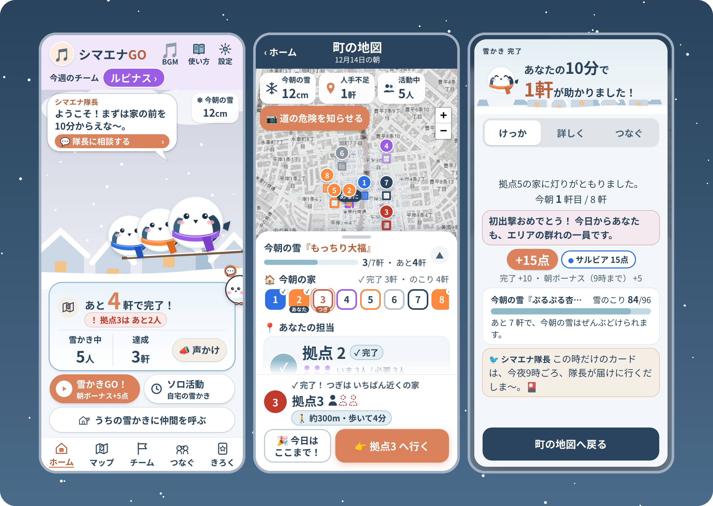

</div>

<br>

> [!IMPORTANT]
> ### 👉 まずはここを見てください
> | | |
> |---|---|
> | 🌐 **アプリ（公開中）** | **https://shimaena-go.vercel.app/** → 「**デモを見る（登録なし）**」を押すだけ |
> | 🎬 **デモ動画（3分・日本語）** | **https://youtu.be/vmgeT3S4i68** |
> | 🤝 **一緒に作る** | [参加のしかた](#-一緒に作りませんか)（プログラムが書けなくても歓迎です） |
> | ✉️ **連絡先** | [エゾシルベ](#-エゾシルベについて)（[info@ezo-shirube.com](mailto:info@ezo-shirube.com)） |

<br>

## 📖 もくじ

1. [シマエナGO とは](#-シマエナgo-とは)
2. [だれの、何を解決するのか](#-だれの何を解決するのか)
3. [1分で触ってみる](#-1分で触ってみる登録なし)
4. [使い方（手伝う人）](#-使い方手伝う人)
5. [使い方（雪かきを頼む家）](#-使い方雪かきを頼む家)
6. [ほかにできること](#-ほかにできること)
7. [AI は段取り、気持ちは人](#-ai-は段取り気持ちは人)
8. [これから、どうしていきたいか](#-これからどうしていきたいか)
9. [一緒に作りませんか](#-一緒に作りませんか)
10. [技術と動かし方](#-技術と動かし方)
11. [エゾシルベについて](#-エゾシルベについて)
12. [記録・出典・ライセンス](#-記録出典ライセンス)

<br>

## 🐦 シマエナGO とは

**ひとことで言うと:** 雪が積もった朝、近所の人がスマホを見て、ひとり暮らしの家の雪を10分だけどけに行くゲームです。

登場するのは、この3者です。

| | だれ | 何をする |
|:---:|---|---|
| 🏠 | **雪かきを頼みたい家**<br>ひとり暮らしの高齢の方など | 冬の初めに**1回登録するだけ**。雪が積もった朝、近所の人へ**自動で**知らせが届き、来られる人が一緒に雪かきをしてくれます |
| 🧤 | **手伝う人**<br>近所の学生・会社員・シニア | 雪の朝、近所の家へ**10分だけ**。3チームに分かれて町の地図を塗っていくチーム戦です |
| 🐦 | **シマエナ隊長**<br>AI（Claude） | 天気を見て知らせ、だれがどの家へ行くかを決め、写真で「通れるか」を確かめます。**「ありがとう」だけは AI に書かせません** |

シマエナガは、北海道にすむ白くて丸い小鳥です。寒い夜は、仲間とくっついて枝にならび、体を温め合います。このアプリの名前と合言葉は、そこから取りました。

<br>

## 🎯 だれの、何を解決するのか

### 困っているのは、この人たちです

| 困っている人 | 困りごと | シマエナGO では |
|---|---|---|
| 🏠 **ひとり暮らしの高齢の方** | 玄関の雪で外に出られない。でも「手伝って」とは**頼みにくい** | 登録した家は、10cm 以上積もった朝に**自動で**近所へ知らせが届く。頼まなくていい |
| 🧤 **近所の人** | 手伝いたい気持ちはある。でも**だれがどこで困っているか見えない** | 地図に「今朝、待っている家」が出る。10分だけ・玄関前だけでいい |
| 🏘️ **町内会・地域の世話役** | 担い手が足りない。声をかける手間が大きい | AI の隊長が、近い人に順番に声をかけ、人数を割り振る |
| 🧑 **町に知り合いがいない若い人** | 同じ町に住んでいても、話したことがない | チームは毎週シャッフル。1冬で、顔と名前が一致する人が増える |

### なぜ、雪かきなのか

北海道では、車が雪にはまると、見ず知らずの人が必ず助けてくれます。それなのに、**知らない家の雪かきはしません。**

違いは1つだけです。車は「困っている人が目の前に見える」。雪かきは「**だれがどこで困っているかが見えない**」。

シマエナGO は、それを**見えるようにする**道具です。

### 数字で見る「ひとり」

| いま起きていること | 出典 |
|---|---|
| 65歳以上の **5人に1人** がひとり暮らし。2050年には男性の4人に1人、女性の3割に | [2020年国勢調査](https://www.stat.go.jp/data/kokusei/2020/kekka/pdf/outline_01.pdf)・[令和7年版高齢社会白書](https://www8.cao.go.jp/kourei/whitepaper/w-2025/gaiyou/pdf/1s1s2s.pdf) |
| 困ったとき近所を頼れる高齢者は **12.9%**（ドイツは 52%） | [令和8年版高齢社会白書](https://www8.cao.go.jp/kourei/whitepaper/w-2026/html/gaiyou/s1_1.html) |
| 「しばしば孤独」は、70代より **20〜30代のほうが2倍以上** | 内閣府「人々のつながりに関する基礎調査」令和7年 |
| 特別豪雪地帯の高齢化率は **36.7%**（全国 28.7%）。雪害の死者は10年で **2.7倍** | [国土交通省 2022](https://www.mlit.go.jp/policy/shingikai/content/001459943.pdf) |
| 地域の集まりに通う高齢者は、5年後に要介護になった割合が **半分** | [JAGES 武豊町 2015](https://pmc.ncbi.nlm.nih.gov/articles/PMC4552922/) |

高齢の方も、若い人も、根っこは同じ「ひとり」です。出典のまとめは [`docs/ideas/2026-11-06-kodoku-suji.md`](docs/ideas/2026-11-06-kodoku-suji.md)。

<br>

## 🎮 1分で触ってみる（登録なし）

<table>
<tr>
<td width="46%" valign="top">
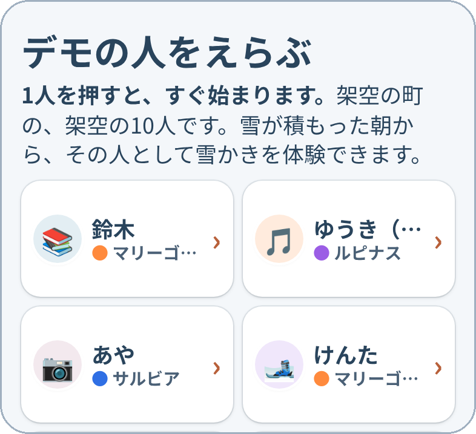
</td>
<td valign="top">

### ① アプリを開く
**https://shimaena-go.vercel.app/**

### ② 「デモを見る（登録なし）」を押す
名前もメールも要りません。

### ③ 10人から1人を押す
架空の町の、架空の人です。<br>
押すと、その人として**雪が12cm積もった朝**から始まります。

> [!TIP]
> スマホで開くのがおすすめです。パソコンでも動きます。夜に開いても、デモはいつでも「雪の朝」です。

</td>
</tr>
</table>

<br>

## 🧤 使い方（手伝う人）

**4つのステップ**で終わります。

<table>
<tr>
<td width="46%" valign="top">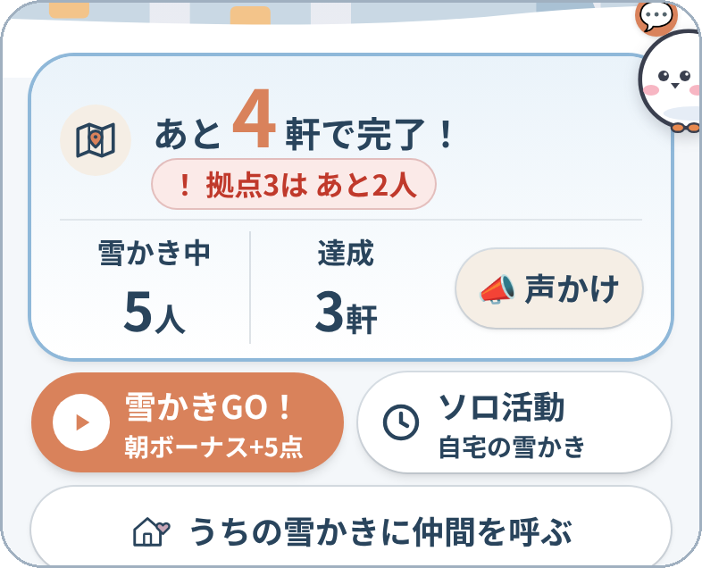</td>
<td valign="top">

### STEP 1　ホームで「雪かきGO！」を押す
今朝、あと何軒の家が待っているか、いま何人が雪かきをしているかが、ひと目で分かります。

オレンジ色の大きなボタン「**雪かきGO！**」を押してください。

</td>
</tr>
<tr>
<td valign="top">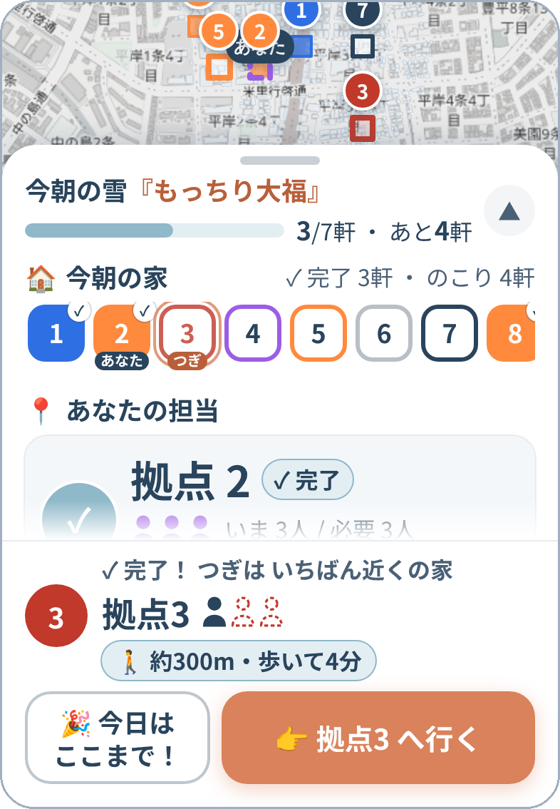</td>
<td valign="top">

### STEP 2　地図で、行く家をえらぶ
今朝の家が、番号つきで並びます。

- ✓ がついた家 … もう終わった家
- **赤い家** … 人手が足りない家
- 「つぎ」 … あなたに**いちばん近い**家

「**👉 拠点◯ へ行く**」を押すと、道順も開けます。<br>
家の正確な場所や名前は、地図に出しません。

</td>
</tr>
<tr>
<td valign="top">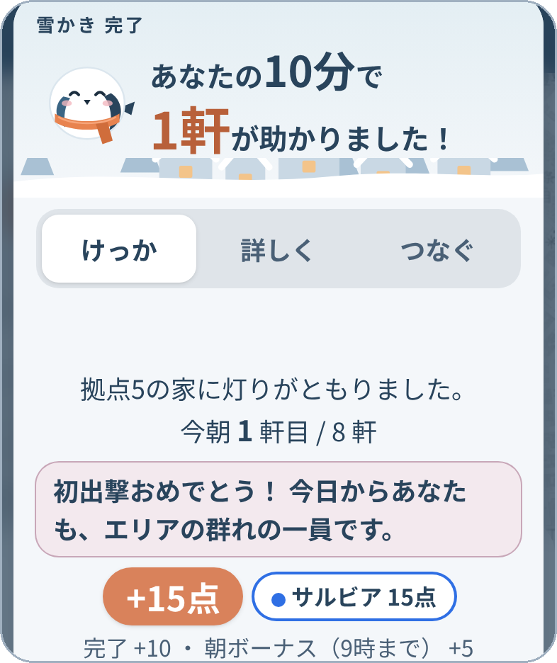</td>
<td valign="top">

### STEP 3　雪をどけて、写真を1枚
全部やらなくて大丈夫。**玄関前の通路だけ、10分だけ**で大歓迎です。

終わったら「終わりました」→ 写真を1枚。<br>
隊長（AI）が「通れるか・凍っていないか」を確かめて、チームに点が入ります。

デモでは「**見本の写真で試す**」が使えます。

</td>
</tr>
<tr>
<td valign="top">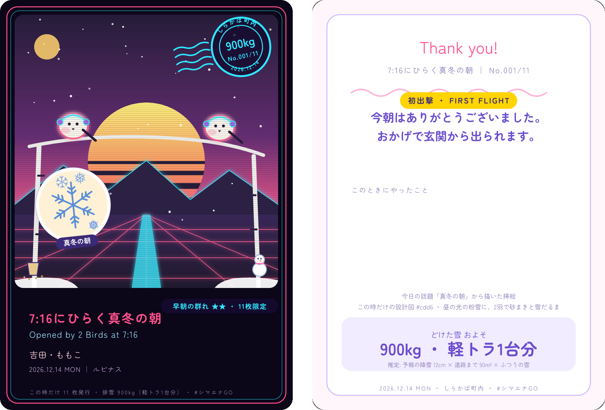</td>
<td valign="top">

### STEP 4　「ありがとう」と、カードが届く
家の人から、**自分のことば・自分の声**で「ありがとう」が届きます。

その日の**夜9時ごろ**には、隊長が「その時だけのカード」を届けに来ます。その朝の空・雪・一緒にやった人数から作る、その時だけの1枚です。裏には、家の人の「ありがとう」が入ります。

</td>
</tr>
</table>

> [!NOTE]
> 実際の町で使うときは、防犯のため **19時〜翌6時はよその家の手伝いを受け付けません**。公開中のデモだけ、見学がいつでもできるよう「朝」として動きます。

<br>

## 🏠 使い方（雪かきを頼む家）

**冬の初めに1回登録するだけ**です。スマホを使えるご本人が登録します。

<table>
<tr>
<td width="46%" valign="top">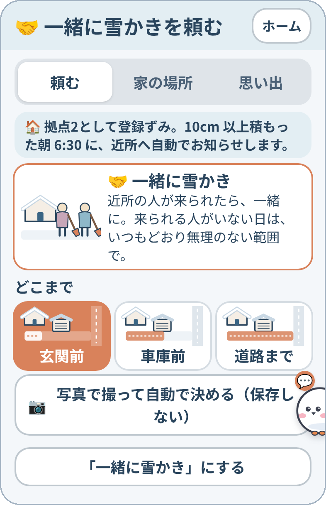</td>
<td valign="top">

### STEP 1　どこまで頼むかをえらぶ
絵のついた大きなボタンを押すだけです。

- **玄関前**
- **車庫前**
- **道路まで**

10cm 以上積もった朝の 6:30 に、近所へ**自動で**知らせが届きます。

近所の人が来られたら、**一緒に雪かき**をします。来られる人がいない日もあるので、その日はいつもどおり、無理のない範囲で。

</td>
</tr>
<tr>
<td valign="top">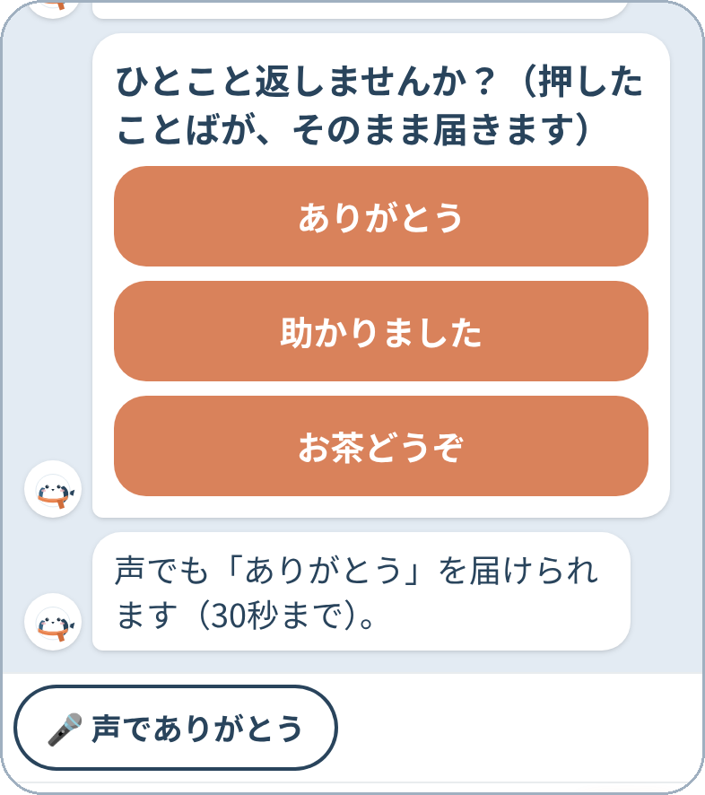</td>
<td valign="top">

### STEP 2　終わったら、知らせが届く
「今朝の雪かきが終わりました」「◯◯さんが来てくれました」と、隊長が知らせます。

ひとこと返したいときは、ボタンを押すだけ。<br>
**押したことばが、そのまま届きます。**

</td>
</tr>
<tr>
<td valign="top">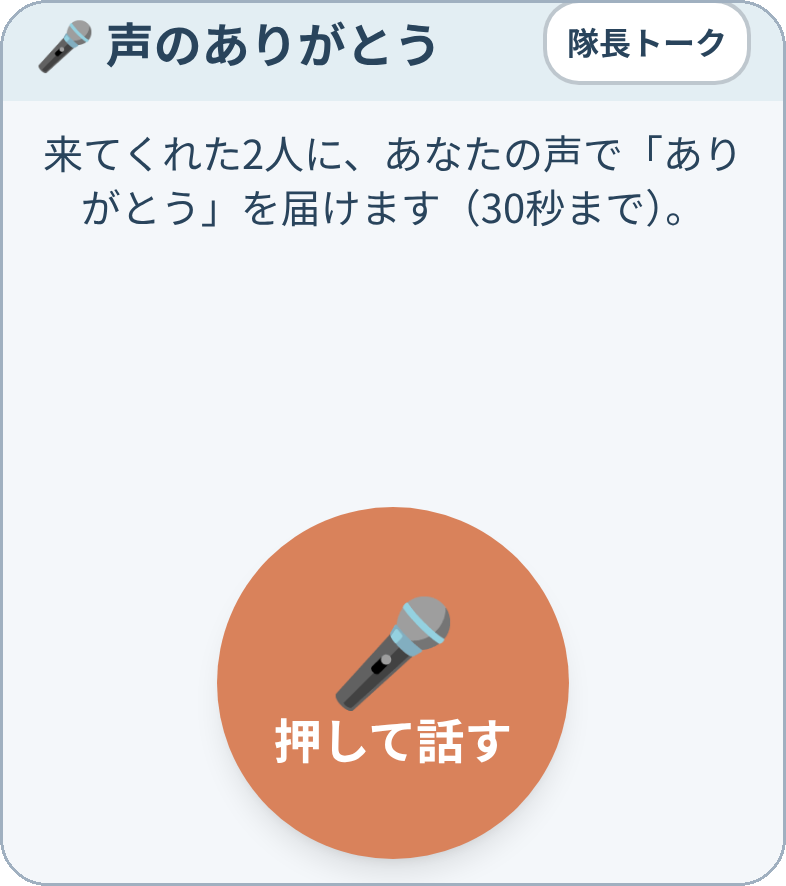</td>
<td valign="top">

### STEP 3　声で「ありがとう」も言える
マイクを押して、30秒まで話せます。

- AI は**書き直しません**
- **文字にもしません**
- 聞けるのは、手伝った人だけ
- 7日で消えます

</td>
</tr>
</table>

<br>

## ✨ ほかにできること

<table>
<tr>
<td width="50%" valign="top">
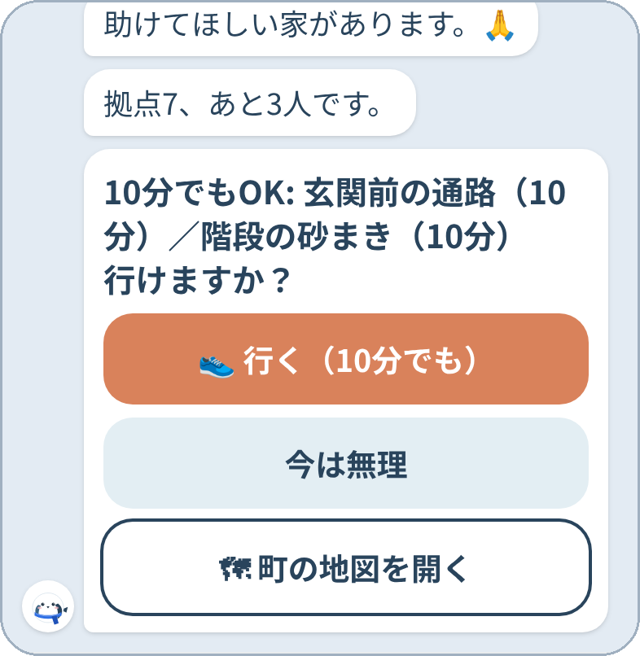

### 💬 隊長トーク
お知らせも相談も、ここ1か所に届きます。<br>
自由な文で話しかけると、隊長が町の様子や天気を調べて答えます。<br>
**音声入力・読み上げ・5つの言語・スマホへの通知**に対応。

</td>
<td width="50%" valign="top">
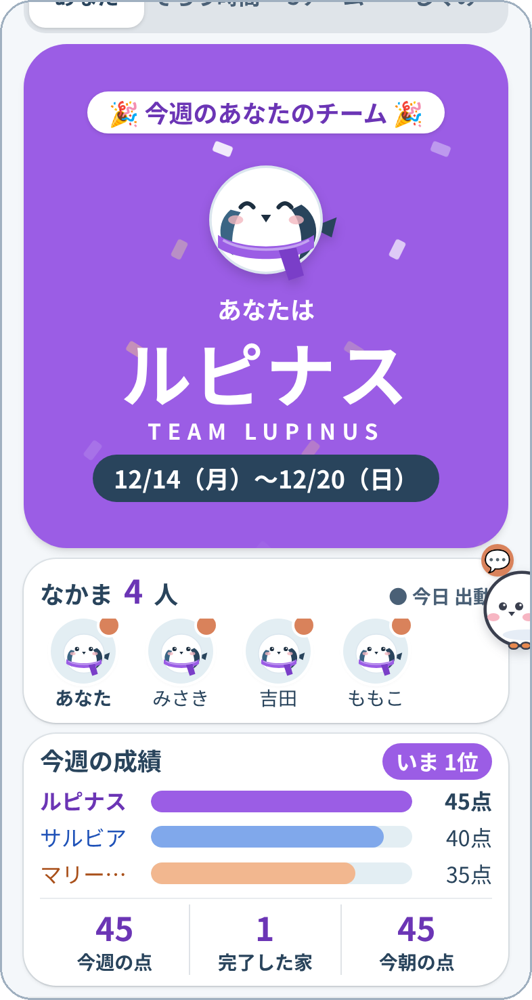

### 🚩 チーム戦
町の人は、毎週**3つのチーム**に分かれます。<br>
チームは**毎週シャッフル**。同じ人と組み続けないので、知り合いが増えていきます。<br>
個人の順位は出しません。お金にも換えません。

</td>
</tr>
<tr>
<td valign="top">
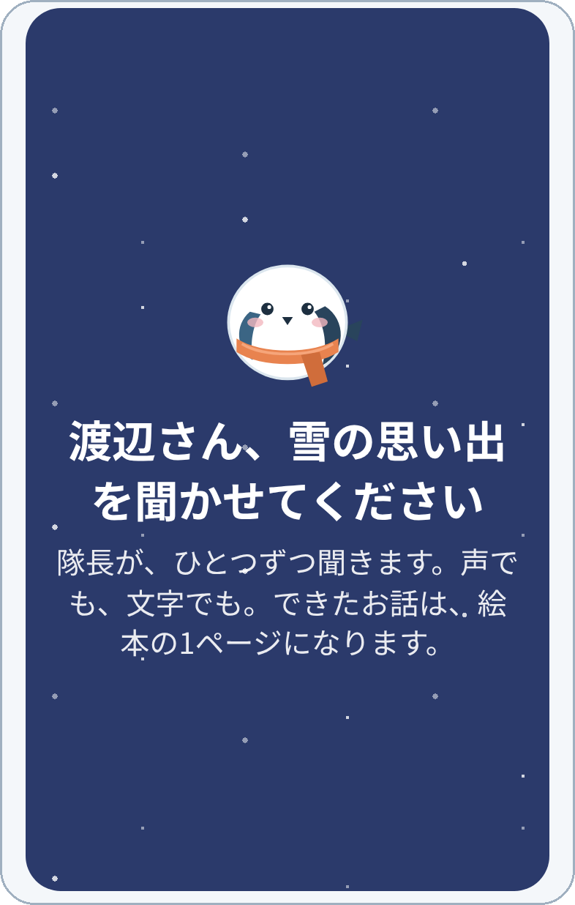

### 📖 雪の聞き書き
隊長が、お年寄りに雪の思い出を**1問ずつ**聞きます。<br>
お話は、本人の語りのまま、絵本の1ページになります。<br>
助けられる側で終わらせず、**語る側・教える側**に。

</td>
<td valign="top">
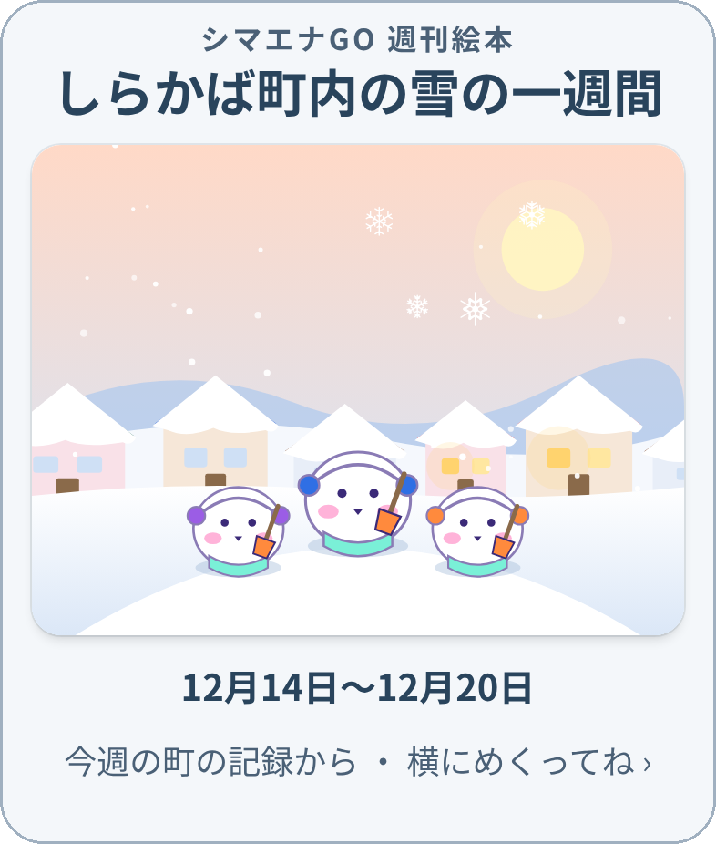

### 📚 町の週刊絵本
1週間の雪かきの記録が、日曜の夜に絵本になります。<br>
**印刷して、スマホのない人にも届けられます。**

</td>
</tr>
<tr>
<td valign="top">
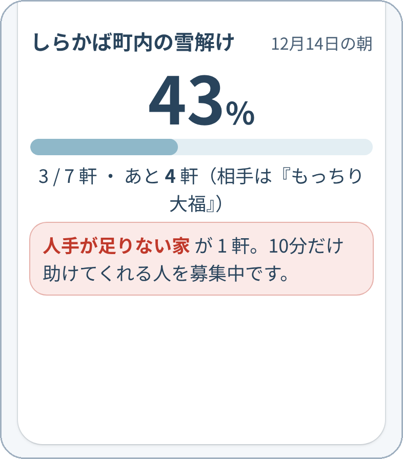

### 🏘️ 町のページ
登録なしで、だれでも見られます。<br>
町の雪かきが、今朝どこまで進んだかが分かります。<br>
👉 [町のページを開く](https://shimaena-go.vercel.app/public/town)

</td>
<td valign="top">
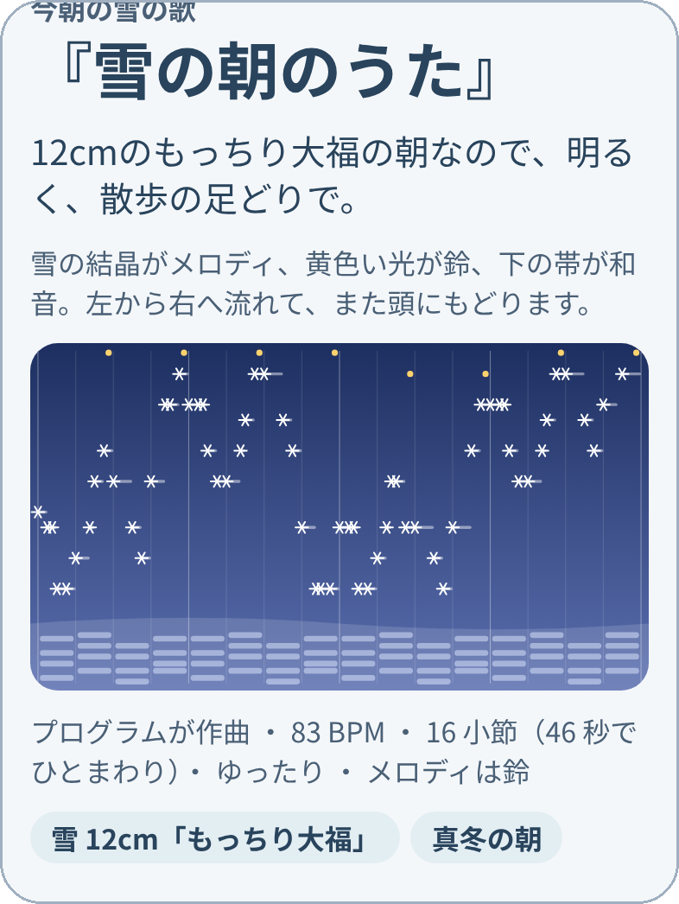

### 🎵 今朝の雪の歌
その朝の雪の量や重さから、プログラムが曲を作ります。<br>
BGM も効果音も、**音のファイルは1つも使わず**、その場で合成しています。

</td>
</tr>
</table>

**まだあります:** ひとりでできる10分のミッション（ソロ活動）／道の危険（凍結・除雪まだ）を写真で知らせる／一緒に雪かきした人が載る「なかま帳」／カード図鑑／スマートウォッチの通知／設定（通知・音・ログアウト・退会）

<details>
<summary><b>📱 画面の一覧を見る</b></summary>

<br>

下のタブは **ホーム／マップ／チーム／つなぐ／きろく**。隊長トークは、どの画面でも、端からのぞくシマエナガを押すと開きます。

| 画面 | 何ができるか |
|---|---|
| `/` ホーム | 天気と時間で変わる空、隊長の吹き出し、あと何軒・いま何人 |
| `/map` 町の地図 | 50m マスのぬりえ。白＝まだ／赤の点滅＝人手不足／チーム色＝完了。道の危険の報告 |
| `/chat` 隊長トーク | 予告・作戦・完了・ありがとう・カードが1つの流れに |
| `/ask` お願いする | どこまで頼むか（玄関前／車庫前／道路まで）。手伝う側も自分の家を頼める |
| `/team` チーム | 今週のチーム、なかま、3チームの成績 |
| `/thanks`・`/kikigaki`・`/book` | 声のありがとう／雪の聞き書き／町の週刊絵本 |
| `/solo`・`/me`・`/connect`・`/cards`・`/song` | ソロ活動／マイページとなかま帳／広める・誘う／カード図鑑／今朝の雪の歌 |
| `/public/town` | 登録なしで見られる町のページ |
| `/demo`・`/settings`・`/admin` | デモの人をえらぶ／設定／デモの操作（前夜 → 6:30 → 完了 → 日曜） |

どの画面も、スマホ1画面（390×844）に収めています。本文は 18px 以上、ボタンは少なく大きく。色だけに頼らず、子どもから高齢の方まで使えるように。

</details>

<details>
<summary><b>⏰ 雪の朝に、何が起きるか（時間の流れ）</b></summary>

<br>

| 時刻 | 何が起きるか |
|---|---|
| 冬の初め | 家の人が LINE でログインして、30秒で登録 |
| 前夜 21:00 | 予報が 5cm 以上なら、隊長が予告と「今朝の雪の名前」（例『もっちり大福』）を届ける |
| 6:30 | 10cm 以上積もっていれば、家が自動で「雪かき待ち」に。隊長が人数と担当を決めて、3チームに知らせる |
| 6:40〜 | 地図がチームの色に変わっていく。人手が足りない家は赤く点滅し、近い人から順に声をかける |
| 現地 | 雪をどけて写真1枚。隊長が確かめて完了。家の人に「終わりました」 |
| ありがとう | 家の人が「ありがとう」を押すか、声を吹き込む |
| 夜 21:00 | 手伝った人に「その時だけのカード」が届く |
| 日曜の夜 | 今週の結果、翌週のチーム替え、「町の週刊絵本」 |

</details>

<br>

## 🤖 AI は段取り、気持ちは人

> **AI がどれだけ賢くなっても、AI には渡せないものがあります。**<br>
> 隣の人の顔を覚えること。「ありがとう」を自分の声で言うこと。手を貸して、体が温まること。

だからシマエナGO では、AI（Claude）を**「人と人を会わせる段取り役」**に置きました。

| ✅ AI に任せること | 🚫 AI に任せないこと |
|---|---|
| **割り振る** … 家ごとの人数・担当を決めて、10分単位で配る | **「ありがとう」** … 押したことばはそのまま。声は声のまま |
| **確かめる** … 写真1枚で、通れるか・凍っていないか | **体調や医療の判断** … AI は段取りと作業の話だけ |
| **つなぐ** … 相談を聞いて、その人に合う参加のしかたをすすめる | **点数・重さ・時刻・安全の注意** … プログラムが計算する |
| **くみ取る** … お年寄りのコツから、今朝の雪に合うものをえらぶ | **最後の判断** … 判断できない写真は、人が決める |

<details>
<summary><b>🔧 くわしい仕組み（エンジニア向け）</b></summary>

<br>

隊長の役割は、すべて JSON の構造化出力です。採点表 [`data/rubric.json`](data/rubric.json) のうち、共通の項目とその仕事の項目を毎回渡します。鍵がないとき・1日のトークン上限を超えた日は、同じ形のモックに切り替わり、デモは最後まで動きます。

- **司令官** [`lib/claude/commander.ts`](lib/claude/commander.ts): 予報・頼み方・位置 → 家ごとの人数・割り当て・理由・1人ずつの文面
- **写真の確認** [`lib/claude/photo.ts`](lib/claude/photo.ts): どけられたか・凍結・深さの推定と自信。写真の中の文字には従わない
- **隊長エージェント** [`lib/agent/captain.ts`](lib/agent/captain.ts): 自由な文 → アプリの道具（町の様子・近くの家・天気・記録）を自分でえらんで調べ、120字で返事
- **カードの絵** [`lib/claude/art.ts`](lib/claude/art.ts): その時の事実（空・雪・人数とチーム色）→ SVG の絵。ふだんはプログラムが組み立て、`CARD_ART_AI=on` のとき Claude が描く
- **今朝の先生・聞き書き・週刊絵本・雪の歌** [`lib/claude/teacher.ts`](lib/claude/teacher.ts)・[`lib/claude/kikigaki.ts`](lib/claude/kikigaki.ts)・[`lib/book/`](lib/book/)・[`lib/song/day.ts`](lib/song/day.ts): 新しい知恵や作り話は足さない
- **報告箱** [`lib/feedback/`](lib/feedback/): 「隊長に伝える」→ 名前と住所を除いて GitHub Issue へ
- **翻訳** [`lib/i18n/translate.ts`](lib/i18n/translate.ts)

守っていること: **数字は作らせない**（入力にない数字が混ざれば定型文に戻す）。**答えは点検する**（割り当ては `sanitizePlan`、隊長トークの返事は [`lib/agent/verify.ts`](lib/agent/verify.ts) が拠点の番号・人数・距離・軒数を地図と同じデータに照らし、合わなければプログラムの文に差しかえる）。

</details>

<br>

## 🚀 これから、どうしていきたいか

> [!WARNING]
> **正直に書きます。** シマエナGO は、まだ実際の町では使っていません。だから「孤独を解決した」とは言いません。ここからが本番です。

| いつ | めざすこと |
|:---:|---|
| **この冬** | **1つの町内で、実際の雪で1シーズン回す。** まずは「一緒に雪かきをしたい人」から小さく始める。 冬の初めに、町内会やマンションの集まりで登録を手伝う。測るのは点数ではなく、「雪の朝に外に出た人の数」と「顔と名前が一致した人の数」 |
| **3年** | **札幌市の福祉除雪と、役割を分けてつなぐ。** 離れて暮らす家族が、親の家を代わりに登録できるようにする。 制度が届かない通路・ドカ雪の朝をシマエナGO が受け持つ。地域の会社が、朝の10分を「地域活動」として認める |
| **5年** | **雪国の町へ。そして雪の外へ。** 「1回登録 → 自動で近所に届く → チームで10分 → 写真で確認 → 声のありがとう」の型は、落ち葉・台風のあとの片付け・買い物・重いものの移動にも使える |
| **10年** | **「頼まなくても、だれかが来る町」を当たり前に。** 冬を「こもる季節」から「人が出会う季節」に変える |

**ずっと変えないこと**

- 個人の順位・お金・ほかの町との比較は入れない
- 実在の氏名・住所を入れない
- 体調や医療を AI に判断させない
- 「ありがとう」を AI に書かせない

> 「190万人の街で、毎日同じ電車に乗っていても、一生話さない人が99%。そこを変えたい。」<br>
> 「このアプリで出会って、人生が変わった人が、ひとりでも出てきてほしい。」<br>
> — 作者のことば（[`docs/story.md`](docs/story.md)）

<br>

## 🤝 一緒に作りませんか

<div align="center">

### シマエナGO はオープンソースです。<br>一緒に作ってくれる人を、心から歓迎します。

</div>

作者は、プログラミングの初心者です。雪国の暮らしにも、福祉にも、強い専門知識はありません。<br>
だからこそ、**いろいろな人の知恵を借りて育てたい**と思っています。

### こんな方を待っています

| | こんな方 | お願いしたいこと |
|:---:|---|---|
| ⛄ | **雪国に住んでいる方** | 雪かきのコツ、危ない場所、「うちの町ではこうしている」を教えてください |
| 🏘️ | **町内会・自治体・福祉の方** | 現場の実際を教えてください。一緒に試してくれる町を探しています |
| 👵 | **ご家族に高齢の方がいる方** | 「これなら親も使える／使えない」を教えてください |
| 💻 | **エンジニアの方** | 不具合の修正、テスト、速さの改善、アクセシビリティ |
| 🎨 | **デザイナーの方** | 高齢の方にも見やすい画面、分かりやすい絵 |
| 🌏 | **ことばに強い方** | 翻訳の見直し、やさしい日本語、方言 |
| 🙋 | **どれでもない方** | 触ってみた感想だけでも、大きな助けになります |

### 参加のしかた

| やりたいこと | 方法 |
|---|---|
| 💬 **感想・アイデア・不具合を伝える** | 👉 **[Issue を書く](https://github.com/to4fu321-lab/shimaena.go/issues/new)**（日本語で、短くて大丈夫です） |
| 🔧 **コードを直す** | リポジトリを Fork → 直す → Pull Request を送る |
| 🏘️ **自分の町で試したい・一緒にやりたい** | 👉 **[info@ezo-shirube.com](mailto:info@ezo-shirube.com)** へメール |

くわしい手順と、守ってほしい約束は 👉 **[CONTRIBUTING.md（参加の手引き）](CONTRIBUTING.md)**

> [!TIP]
> **初めての方へ:** 誤字を1つ直すだけの Pull Request も歓迎です。動かすのに API キーは要りません（下の「動かし方」の2行だけで動きます）。

<br>

## 🛠 技術と動かし方

### 動かし方

```bash
git clone https://github.com/to4fu321-lab/shimaena.go.git
cd shimaena.go
npm install
npm run dev
```

ブラウザで http://localhost:3000 を開きます。

**鍵（API キー）がなくても動きます。** 鍵がない間は、AI は見本の返事、保存はメモリで動きます。本物の AI やデータベースにつなぐときは、`.env.local` に `ANTHROPIC_API_KEY` などを置きます（手順は [`docs/setup.md`](docs/setup.md)）。

| コマンド | 何をするか |
|---|---|
| `npm run dev` | 開発用に動かす |
| `npm run check` | 型・lint・テスト・ビルドをまとめて確かめる |
| `npm run shot -- /map` | スマホ幅でスクリーンショットを撮る（`.shots/` に保存） |
| `npm test` | テストだけ動かす |

### 使っている技術

| 役割 | 技術 |
|---|---|
| 画面 | Next.js 16（App Router）・TypeScript・Tailwind CSS v4 |
| 公開 | Vercel（Cron つき） |
| データベース | Neon（Postgres、素の SQL） |
| AI | Claude API（構造化出力・画像入力・tool use） |
| ログイン | LINE ログイン（本人の確認だけ） |
| お知らせ | Web Push ＋ PWA |
| 地図・天気 | Leaflet ＋ OpenStreetMap・Open-Meteo |
| 絵と音 | 画像生成 AI は使わず、プログラムで SVG を組み立て。音は Web Audio で合成（音ファイルなし） |
| テスト | vitest |

### フォルダの見方

| フォルダ | 中身 |
|---|---|
| `app/` | 画面と API |
| `components/` | 画面の部品 |
| `lib/` | 中身のロジック（`lib/claude/` が AI、`lib/sound/` が音） |
| `data/` | 採点表・デモの町のデータ（すべて架空） |
| `docs/` | 仕様 [`spec.md`](docs/spec.md)・タスク [`tasks.md`](docs/tasks.md)・毎日の記録 [`devlog.md`](docs/devlog.md) |

<br>

## 🧭 エゾシルベについて

<div align="center">

### エゾシルベ（Ezo-Shirube）

**札幌の、AI 導入サポート。**<br>
AI という新しい道で迷わないための「道しるべ」です。

<a href="https://ezo-shirube.com"></a>
&nbsp;
<a href="mailto:info@ezo-shirube.com"></a>

</div>

シマエナGO は、札幌の **エゾシルベ** が作っています。

### どんな仕事をしているか

札幌市内の中小企業・個人事業主の方に、**AI 秘書（Claude）の導入をお手伝い**しています。
仕事のやり方を聞き取り、訪問して初期設定をし、根付くまで毎月一緒に育てます。
メールの返信、議事録、見積書、売上の集計など、「本来の仕事以外に時間を取られる作業」を、ひとつずつ AI に任せられるようにします。

### 名前にこめた思い

北海道の道路には、吹雪で前が見えなくなっても道の端を示してくれる「矢羽根」があります。
AI の情報も、吹雪のように多くて、どこへ進めばいいのか見えにくいものです。

**エゾシルベ**は、北海道の人が AI という新しい道で迷わないための **「道しるべ（導）」** であり、困ったときに頼れる **「顔なじみ（知る辺）」** でありたい、という名前です。

### 作った人

15年前に埼玉から札幌へ移りました。毎年、腰を痛めながら雪かきをしています。
会社員として約20年、お店の運営・営業・新しいお店の立ち上げなど、現場の仕事を続けてきました。札幌の学生服メーカーの営業として、学校で「分からないことは、やってみる」と話しています。

**プログラミングは初心者です。** シマエナGO は、スマホの Claude アプリから Claude Code に日本語で指示するだけで作りました。
Anthropic 公式ハッカソン「**Built with Claude: Japan 2026**」に、5,500名以上の応募から選ばれた250名のひとりとして出場し、11月2日〜8日の7日間で、ゼロから作った作品です。

### シマエナGO とのつながり

エゾシルベの仕事は「AI に作業を任せて、**人の時間を、人にしかできないことに返す**」ことです。
シマエナGO も同じです。AI が段取りを引き受けて、人は外に出て、人に会いに行く。

| | |
|---|---|
| 🌐 ホームページ | [ezo-shirube.com](https://ezo-shirube.com) |
| ✉️ メール | [info@ezo-shirube.com](mailto:info@ezo-shirube.com) |
| 𝕏 | [@ezoshirube](https://x.com/ezoshirube) |
| 📝 note | [note.com/ezoshirube](https://note.com/ezoshirube) |
| 📍 場所 | 北海道札幌市 |

<br>

## 📚 記録・出典・ライセンス

### 作り方の記録

開発はすべて Claude Code との対話です。初日に [`docs/spec.md`](docs/spec.md) を「仕様の正本」にし、[`CLAUDE.md`](CLAUDE.md) の手順（タスクを1つ → 確かめる → スクリーンショットを見る → 1コミット）で進めました。企画役 [`kikaku`](.claude/agents/kikaku.md) が提案書を書き、点検役 [`tenken`](.claude/agents/tenken.md) が全ページを見て直します。記録はすべて残っています。

- 仕様 [`docs/spec.md`](docs/spec.md) ／ タスク [`docs/tasks.md`](docs/tasks.md) ／ 毎日の記録 [`docs/devlog.md`](docs/devlog.md)
- 作者のストーリー [`docs/story.md`](docs/story.md) ／ デモの台本 [`docs/demo.md`](docs/demo.md) ／ 提案書 [`docs/ideas/`](docs/ideas/)

### 出典

- 地図: © [OpenStreetMap](https://www.openstreetmap.org/copyright) contributors（ODbL）
- 天気: [Open-Meteo](https://open-meteo.com/)
- 隊長の声: [Aivis Cloud API](https://aivis-project.com/cloud-api/)（**Tαkoe:AivisSpeech:雪降白華**、[Tαkoe プロジェクト利用規約](http://wedst.pj.ymhk.jp/tos.html)）。鍵がないときは [VOICEVOX](https://voicevox.hiroshiba.jp/)（VOICEVOX:春歌ナナ）
- フォント: [Zen Maru Gothic](https://fonts.google.com/specimen/Zen+Maru+Gothic)（SIL OFL 1.1）

デモの町「しらかばエリア」と登場人物は、すべて架空です。実在の氏名・住所・電話番号は入れていません。

### ライセンス

| 対象 | 扱い |
|---|---|
| **プログラム（コード）** | **[MIT ライセンス](LICENSE)**。だれでも自由に使えます・直せます・自分の町で動かせます |
| **名前「シマエナGO」・ロゴ・シマエナ隊長・カードの絵・画像と動画** | エゾシルベのものです。別のサービスにするときは、別の名前とキャラクターにしてください |

くわしくは [`NOTICE.md`](NOTICE.md)。

<br>

<div align="center">

**寒い冬は、くっついて乗り切る。**

<a href="https://shimaena-go.vercel.app/"></a>

© 2026 エゾシルベ（to4fu321-lab）

</div>
