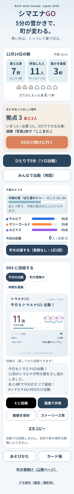
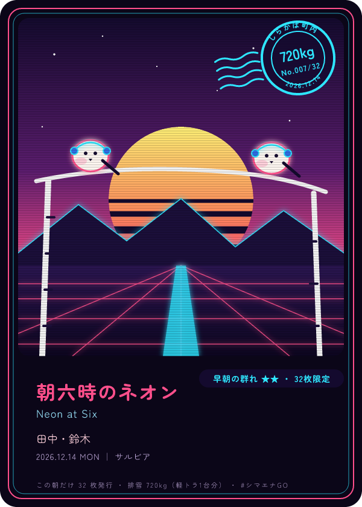
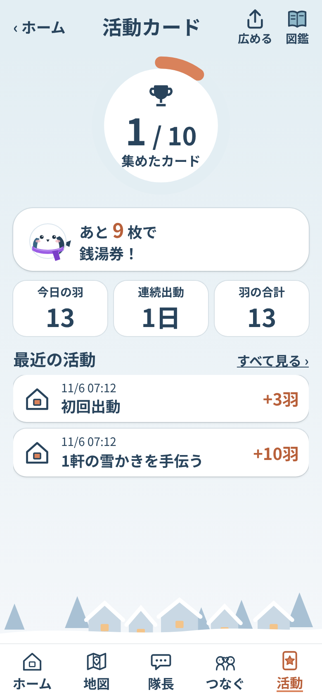
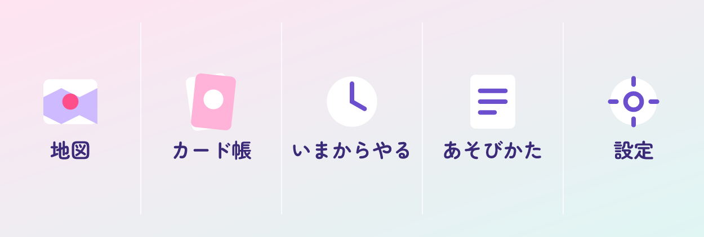

# シマエナGO

**寒い冬は、くっついて乗り切る。**

雪の朝に LINE で点呼が届き、町内のランダム3チームが、ひとり暮らしの家の雪をどける。
参加するほど、その朝だけのカードが増えていく雪かきゲームです。

Built with Claude: Japan 2026（Anthropic × Cerebral Valley 主催）提出作品。
**11月2日〜11月8日の期間中に、このリポジトリ上でゼロから制作しています。**

<p>



</p>
<p>



</p>
<p>

</p>
<p>


</p>

## 公開中のアプリ
- https://yukikaki-karano-kaihou.vercel.app/

| 画面 | 何ができるか |
|---|---|
| `/` ホーム | 町の雪解け（雪ボスのHP・○/○軒・3チームの得点・今日の応援）→ 今日の自分（羽・連続出動）→ 大きなボタン（ソロ出動／5分だけ出動／チーム出撃）→ あと1人で救える家 → 今日のシマエナカード → SNS に投稿する |
| `/solo` ソロ出動 | 仲間がいなくても1人で 3〜5分のミッション（見回り・雪の報告・自分の家の雪かき など）。羽ポイント・連続出動・カード。SOLO CLEAR の演出と、SNS に投稿 |
| `/public/town` 公開ページ | LINE 登録前でも見られる町の雪解け（集計だけ）。今日と今週の数字・町を応援する・LINE で参加・シマエナ診断・SNS で広める |
| `/public/diagnosis` シマエナ診断 | 登録なしの5問で「あなたは何シマエナ？」。結果カードを SNS でシェア |
| `/rules` 使い方 | 触って覚えるチュートリアル（6枚のスライド。スマホはスワイプ、PC はボタンと ← → キー）。LINE の練習（点呼に答える → 地図で「行く」→ 雪かき → 写真で完了）、最後に LINE で参加。くわしいルール（持ちもの・けがをしないために・点数など）は開け閉めできる項目で |
| `/map` 地図 | 50m マスのぬりえ。得点バーと今朝の雪（雪ボス）のHP、全軒完了で「討伐」。LINE から開くと自分の割り当て・司令官の理由・「行く」「終わりました（写真）」「人手が足りない」。完了すると MISSION CLEAR（点の内訳・雪HPの減り）。「あと1人で救える家」と「5分だけ助けに行く」「5分だけ参加」。「結果をコピー」（絵文字グリッド） |
| `/cards` 活動カード | スクロールしない1画面。集めたカードの丸いゲージ、次のご褒美までのひとこと、最近の活動3件 |
| `/cards/book` カード図鑑 | その朝だけのカード。正方形と 4:5 で保存。図鑑（5タッチの取得状況・リボン・今週の称号）と、ご褒美（想定。架空の地元の銭湯・お店） |
| `/today` 今朝のようす | ホームの「くわしく」。今日のあなた・雪のこり・チームの得点・実況・応援・今日のカード・SNS に投稿・設定 |
| `/admin` デモ操作 | 前夜の予告 → 点呼 → 回答 → 司令官 → 完了 → 駆けつけ → 日曜のまとめ、をボタンで。DB の準備とリッチメニュー作成も |
| LINE 公式アカウント | 登録（役割 → 位置情報 → 2問）、点呼、作戦、「行く」、写真で完了（「それでも完了にする」も）、ヘルプ通知、カード、家族への通知と応援スタンプ、依頼者のありがとう点呼、「いまからやる」 |

## デモ動画
（3分・日本語。提出時に URL を記入。台本は [`docs/demo.md`](docs/demo.md)）

## 誰の、どんな課題を、どう解決するか
- **誰の**: 札幌の一軒家にひとりで暮らす高齢者。雪の朝、玄関から道路まで出られない。
- **どんな課題**: 近所に頼みたくても頼みにくい。手伝える人がいても、誰がどこで困っているか分からない。雪かきは早朝の重労働で、「ありがとう」だけでは人が集まらない。
- **どう解決するか**: 雪の朝に LINE で1問だけの点呼。「いいえ」の1タップで、Claude が近所のチームに5分単位の小さな仕事として割り振る。地図が塗られていき、動いた人にはその朝だけのカードが届く。

## 仕組み
詳しくは [`docs/spec.md`](docs/spec.md)。

## Claude の活用（アプリの中）
すべて JSON（構造化出力）で受け取り、採点表 [`data/rubric.json`](data/rubric.json) を毎回システムに入れて同じ基準で判定させます。キーがない環境では、同じ形を返す計算（モック）に自動で切り替わるので、審査用のデモはキーなしでも最後まで動きます。

| 役割 | いつ | 入力 → 出力 | コード |
|---|---|---|---|
| レベル判定 | 登録の2問のあと | 「一人だと何分」「どこまで」→ 家のレベル1〜3・必要人数・5分単位の小タスク・本人への一言 | [`lib/claude/level.ts`](lib/claude/level.ts) |
| 前夜の予告と雪の名前 | 21:00、降雪 5cm 以上 | 予報 → やさしい予告文と、今朝の雪の名前（雪ボス。地図の HP バーに出る） | [`lib/claude/announce.ts`](lib/claude/announce.ts) |
| 司令官 | 6:40 | 予報・点呼の答え・拠点・手伝う人の位置とチーム → 家ごとの重要度・必要人数・割り当て・理由（30字、地図と /admin に出す）・1人ずつの LINE の文面・町内へのまとめ | [`lib/claude/commander.ts`](lib/claude/commander.ts)（答えは `sanitizePlan` で点検） |
| 写真確認と雪質 | 完了写真が届いたとき | 写真 → 雪が除かれたか・通れるか・凍結が残るか・判断できないか・雪質（粉雪／湿り雪／凍った雪）・労いの一言・ひとこと。雪質はカードの排雪 kg（密度）にも使う。判断できない写真は「報告として受け付け」、手動の「それでも完了にする」もある（AI は最終判定者ではない） | [`lib/claude/photo.ts`](lib/claude/photo.ts) |
| カードの文字 | 家が完了したとき | 時刻・人数・雪の量・チーム → デザイン名・英語副題・排雪kg と身近な換算 | [`lib/claude/card.ts`](lib/claude/card.ts) |
| 週末の実況 | 日曜の夜 | 今週の集計 → 実況文と来週へのひとこと | [`lib/claude/weekly.ts`](lib/claude/weekly.ts) |
| ありがとうの一文 | お願いした人が3択（ありがとう／助かりました／お茶どうぞ）を押したとき | 3択とその朝の状況 → カード裏面の一文（40字、名前なし）。手伝った人の LINE にも届く | [`lib/claude/thanks.ts`](lib/claude/thanks.ts) |
| 今朝の実況 | 全軒完了したとき（`/admin` のボタンでも） | 本当の集計（軒数・動いた人数・時刻・合流・駆けつけ）→ 3〜4文。数字は Claude に作らせない | [`lib/claude/recap.ts`](lib/claude/recap.ts) |
| SNS の投稿文 | 家・ソロの完了と今朝の実況のあと（返事を返してから） | 公開用の集計（人数・軒数・雪解け率）→ 115字の下書き。入力にない数字が混ざれば定型に戻す。本人が直して自分で投稿（自動投稿しない） | [`lib/claude/share.ts`](lib/claude/share.ts) |
| ソロ出動のひとこと | ソロのミッションを終えたとき | ミッション・羽・連続日数 → 30字（SOLO CLEAR と個人の活動カード） | [`lib/claude/solo.ts`](lib/claude/solo.ts) |
| 診断のひとこと | シマエナ診断の結果（タイプごとに1日1回） | タイプ → 40字のひとこと | [`lib/claude/quiz.ts`](lib/claude/quiz.ts) |

- 司令官には「エナガ隊長」という声がある（採点表の voice。世話焼きで明るい町内会長風。やさしい日本語のまま。判定には影響しない）。
- 体調や医療は判断しない（採点表の safety に明記）。返事がない家は「声かけ」を提案するだけ。
- 絵（カード・リッチメニュー）は画像生成AIを使わず、SVG を図形から組み立てる（[`lib/cards/svg.ts`](lib/cards/svg.ts)）。

## 技術
- Next.js 16（App Router）/ TypeScript / Tailwind CSS v4 / Vercel（Cron）/ Neon（Postgres、素の SQL）
- Claude API（Claude Opus 5.5、構造化出力、プロンプトキャッシュ、安全判定で断られたときのサーバー側フォールバック）
- LINE Messaging API（Webhook・返信・プッシュ・マルチキャスト・リッチメニュー）＋ LIFF
- Leaflet ＋ OpenStreetMap、Open-Meteo、resvg（SVG → PNG）、vitest（テスト 167 本）

## デザイン「白銀の北海道に、家の灯りがともる。」
- 配色は `app/globals.css` の CSS 変数で一元管理: 雪明かり `#F4F7FA`（背景）／冬の深い青 `#29445C`（文字・見出し・ナビ）／灯りオレンジ `#D9825B`（いちばん大事なボタンだけ）／氷の青 `#8FB8C9`（進捗）／雪椿ピンク `#C8A7B8`（達成の演出）／生成り `#F5EEE5`（やわらかい囲み）。赤は「人手不足」と注意だけ、緑は使わない。
- 子どもから高齢者まで: 本文 16px 以上（既定 18px）、ボタンは高さ 56px 以上（操作ボタンは 64px）、アイコンだけの操作はなし、色だけに頼らず文字と形（✓・！・点滅のわく）でも状態を出す。「人手が足りない」は押す前に一度たずねる。
- トップは「5分の雪かきで、町が変わる。」と、救える家・参加した人・雪かき達成・次に手伝ってほしい場所。完了画面は「あなたの5分で、1軒が助かりました。」と家の窓に灯りがともる演出。

## Claude Code をどう使ったか（スマホだけで開発）
本人はプログラミング初心者で、開発はすべて **スマホの Claude アプリから Claude Code（クラウド）に日本語で指示するだけ** で進めました。パソコンでコードを書いた時間はありません。

1. **仕様を先に決めた**: 初日に Claude と壁打ちして2案を比べ、[`docs/spec.md`](docs/spec.md) を「仕様の正本」にした。Claude はここに書いてないことを足さず、変えたいときは [`docs/devlog.md`](docs/devlog.md) に「提案」として書いて本人に聞く約束（例: 「建物の形を塗る」→ 50m マスに変更）。
2. **ループで自走**: [`CLAUDE.md`](CLAUDE.md) に「1回のループで [`docs/tasks.md`](docs/tasks.md) の未完了の一番上のタスクを1つだけ進める → `npm run check`（lint・型・テスト・build）→ スマホ幅のスクショを自分で見て確認 → 1タスク1コミットで push → devlog に3行」という手順を書き、`/loop` で T01 から T13 まで自走させた。鍵（LINE・Neon）が要るところはボタンや環境変数にして、鍵のないセッションでも本番と同じコードが動く形にした。
3. **本人の役割**: 判断（仕様・デザインの選択）、鍵の準備（LINE Developers・Neon・Vercel の環境変数）、実機での確認、デモ動画。Claude Code からの報告は毎回3行以内（できたこと・見てほしいもの・次）にして、スマホで読める量に。
4. **企画役のエージェント**: [`.claude/agents/kikaku.md`](.claude/agents/kikaku.md) に「コードは変えず、面白さ・広がる仕組みを調べて提案書を書く」役を置いた。
5. **記録はすべて公開**: 日ごとの [`docs/devlog.md`](docs/devlog.md)、タスクの順番 [`docs/tasks.md`](docs/tasks.md)、見送った案 [`docs/plan-b-nuisho.md`](docs/plan-b-nuisho.md)、カードやアイコンの試作 [`docs/design/`](docs/design/)。コミット履歴がそのまま制作の記録です。

## 開発の記録
- 日々の記録: [`docs/devlog.md`](docs/devlog.md)
- 作業の順番: [`docs/tasks.md`](docs/tasks.md)
- 検討して見送った案: [`docs/plan-b-nuisho.md`](docs/plan-b-nuisho.md) ほか

## ローカルで動かす
```bash
npm install
npm run dev
```
`.env.local` に `ANTHROPIC_API_KEY` などを置きます（リポジトリには含めません）。
鍵がない間は、Claude はモック応答、保存はメモリで動きます。

## 公開版（Vercel）の準備
1. Vercel の環境変数に `DATABASE_URL`（Neon）を入れる。
2. `/admin` を開き「DB を準備する」を押す（表を作り、架空の町内データを入れる。何度押しても安全）。
3. 「保存: Neon（参加者 12 人）」と出れば完了。以後、地図とデモ操作の状態は Neon に保存される。
4. 表が増えたとき（`db/schema.sql` が変わったとき）は、`/admin` にまた黄色い枠が出るので、もう一度押す。

### LINE をつなぐ
1. Vercel の環境変数に `LINE_CHANNEL_SECRET`・`LINE_CHANNEL_ACCESS_TOKEN`・`NEXT_PUBLIC_LIFF_ID` を入れる。
2. LINE Developers の Messaging API チャネルで、Webhook URL を `https://yukikaki-karano-kaihou.vercel.app/api/line/webhook` にして「検証」→「Webhook の利用」をオン。
3. LINE Official Account Manager の「応答設定」で、あいさつメッセージ・応答メッセージをオフ（オンのままだと LINE 側の定型文も届く）。
4. 公式アカウントを友だち追加すると、「どちらですか？」から登録が始まる（役割 → 位置情報 → 2問）。家族は「家族の代わりに登録」→ 6桁の連携コードで本人や他の家族を紐づける。

### 朝の一本道（行く → 写真 → 完了）
- 作戦の LINE には「行く」「今朝は行けない」のボタンが付く。現地で終わったら、玄関前から道路側を写した写真を1枚 LINE に送ると、Claude が確認して完了になり、得点が入り、依頼者に「終わりました」が届く。
- 地図（LIFF のエンドポイントは `/map`）を LINE から開くと、ログインした本人の割り当てが出て、下の「行く」「終わりました（写真）」「人手が足りない」が使える。LINE の外では `/map?as=h3` のように架空の人として動かせる（デモ用）。

### ヘルプ通知と見守り
- 人手が足りない家（作戦の時点で不足／現場の「人手が足りない」／作戦のあとの「いいえ」）は、近い順に 300m → 600m → 1km の手伝う側（全チーム）に「5分でもOK」の小タスクを添えて LINE で呼びかける。5分おきに輪を広げ、最後は町内会役員役のサポーター（環境変数 `SUPPORTER_LINE_USER_IDS`、カンマ区切り）へ。
- 点呼に返事がない家は地図で灰色に点滅し、300m 以内の人に「声かけお願い」、家族に「返事がありません」が届く。体調や医療の判断はしない。
- 家が終わると、依頼者と家族に「終わりました」が届く。

### ソロ出動と SNS（v1.3）
- 仲間がいない日も `/solo` で1人の 3〜5分から。現地のミッション（見回り・雪の報告・自分の家の雪かき など）とオンラインの 3分ミッション（雪かき完了にはしない）。同じミッションは1日1回。羽ポイントはチーム得点とは別の個人の記録で、順位には使わない。最初の1枚と5日連続でカード。地図に今日の足あと（50m マスに羽のピン）。
- 公開ページ `/public/town` とシマエナ診断 `/public/diagnosis` は LINE 登録なしで見られる（集計だけ。名前・家・マスの位置は出さない）。
- SNS シェアカード `/api/share/<種類>.png`（今日の出動・町の雪解け・仲間を募集・わたしの活動・診断結果 × 正方形・ストーリーズ・リンクの見出し）。「X に投稿」は投稿画面を開くだけ、「画像で共有」はスマホの共有シート（Instagram など）。
- LINE 参加ボタンには、Vercel の環境変数 `NEXT_PUBLIC_LINE_ADD_FRIEND_URL` に公式アカウントの友だち追加 URL（LINE Official Account Manager →「友だちを増やす」→「友だち追加ガイド」の URL）を入れる。入れるまでは「LINE で『シマエナGO』を検索」と出る。
- 表が2つ増えた（`solo_logs`・`town_cheers`）ので、公開版の `/admin` で「DB を準備する」をもう一度押す。

### ありがとうカード
- 家が完了すると、来た人の数だけカードが発行され、LINE に表と裏の2枚が届く。二度と同じカードは発行されない（通し番号 No.○/○）。
- 絵は画像生成AIではなく `lib/cards/svg.ts` が図形から組み立てる。基本はかわいいシティポップ、7:30 までの完了で 80s レトロウェーブ、20cm 以上で切り絵、2チーム混成で湾岸ポップ、5日連続でドット絵。並ぶシマエナガの数＝来た人数、耳あて＝その人のチーム色、右上に消印（町内名・排雪kg・番号・日付）。
- デザイン名・英語副題・排雪量と身近な換算は Claude がつける（キーがない間は定型）。
- カード帳は `/cards`（LINE から開くと自分のぶん。デモは `/cards?as=h3`）。正方形（Instagram）と 4:5（X）で保存できる。PNG 化は resvg と同梱フォント（Zen Maru Gothic、OFL）。

### 日曜の「今週の群れ」とメニュー
- 日曜の夜（21:00 の cron、または `/admin` の「6」）に、今週の実況（Claude、キーなしは定型）・チーム順位・称号（3日で「早起きのエナガ」、5日で「朝の群れの主」＋レアカード確定）・週の目標ボーナス（関わった家が全部 8:00 までならチーム全員 +20）を LINE で送り、翌週のチームを出撃回数と朝に動ける分でバランスよく組み直す。家族には「今週は N 回手伝ってもらいました」。
- LINE のリッチメニュー（出動する／町の地図／活動カード／使い方。大きいサイズ 2500×1686）は `/admin` の「リッチメニューを作る」で作る（画像は SVG から。見本は `docs/screens/richmenu.png`）。設定は Web の `/settings`。LIFF のエンドポイント URL は公開 URL のルート（`https://yukikaki-karano-kaihou.vercel.app/`）にすると、`/map` と `/cards` が LINE の中で開く。
- 「いまからやる」→ 5／15／30分 を選ぶと、近く（1km 以内）の人手不足の家の小タスクか、作業中の家の偵察を1件提案する。

### 点呼を自動で動かす（Vercel Cron）
1. Vercel の環境変数に `CRON_SECRET`（長いランダムな文字列）を入れる。ないと `/api/cron/*` は動かない。
2. `vercel.json` の cron が、前夜 21:00 JST に予告（Open-Meteo で翌朝 6:00 までの降雪が 5cm 以上のときだけ。日曜は先に「今週の群れ」）、6:30 JST に点呼を送る。
3. 6:40 の作戦配信は、Hobby プラン（cron は2本まで）の Vercel には置かず、**GitHub Actions**（`.github/workflows/plan.yml`、毎日 6:40 JST）から `/api/cron/plan` を呼ぶ。リポジトリの Settings → Secrets and variables → Actions に `APP_URL`（公開 URL）と `CRON_SECRET`（Vercel と同じ値）を入れる。GitHub の定期実行は数分遅れることがあるので、6:40 以降に点呼の答えが届いたときの自動配信も予備として残している。
4. 同じことは `/admin` のボタンで手動でもできる（デモはこちら）。

## データと素材の出典
- 地図と建物の形: © [OpenStreetMap](https://www.openstreetmap.org/copyright) contributors（ODbL）
- 天気: [Open-Meteo](https://open-meteo.com/)
- フォント（カード・メニューの PNG 用）: [Zen Maru Gothic](https://fonts.google.com/specimen/Zen+Maru+Gothic)（SIL Open Font License 1.1、[`assets/fonts/`](assets/fonts/)）
- 地図の表示: [Leaflet](https://leafletjs.com/)（BSD-2-Clause）、SVG の PNG 化: [resvg](https://github.com/RazrFalcon/resvg)（MPL-2.0）
- デモの町内「しらかば町内」と登場人物は架空です。建物の形だけを OpenStreetMap から借りています（`scripts/build-town.cjs`）。

## ルールの遵守
- 期間中の新規制作のみ。既存コードの流用はありません。
- デモ用データはすべて架空の人物・場所です。
