# シマエナGO

**寒い冬は、くっついて乗り切る。**

> 10cm 積もった朝、エリアのランダム3チームが、ひとり暮らしの家の雪をどけに行く。
> 雪かきは入口。目的は、町から「ひとり」をなくすこと。

雪かきをお願いしたい家を「見える」ようにし、ご近所を3チームに分けて、10分単位の仕事として届ける雪かきゲームです。家の人は冬の初めに一度登録するだけ。Claude の「隊長」が家ごとの人数と担当を決め、写真1枚で完了を確かめます。**ただし「ありがとう」だけは AI に書かせず、家の人の声で届けます。**

- 公開中のアプリ: https://shimaena-go.vercel.app/ （登録なしで見られる [町のページ](https://shimaena-go.vercel.app/public/town)）
- デモ動画（3分・日本語）: 提出時に URL を記入。自動で組み立てた版は [`docs/video/demo3min-v2.mp4`](docs/video/demo3min-v2.mp4)（作り方と本人の声への差し替え方は [`docs/video/howto.md`](docs/video/howto.md)）。台本は [`docs/demo.md`](docs/demo.md)
- Built with Claude: Japan 2026（Anthropic × Cerebral Valley 主催）提出作品。**11月2日〜11月8日の期間中に、このリポジトリ上でゼロから制作**しています。

<p>
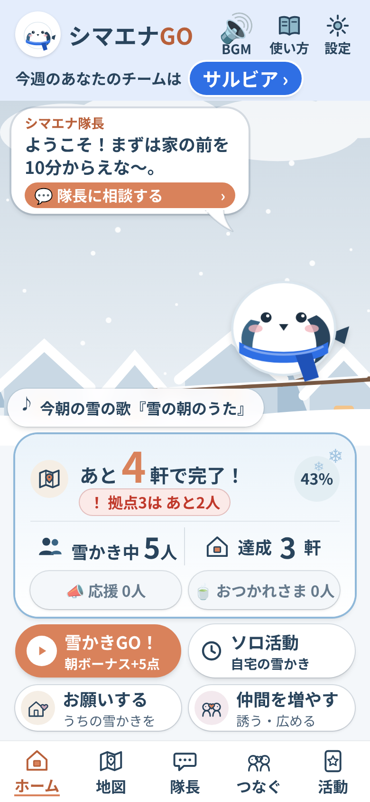
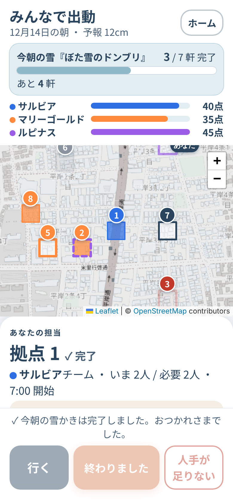
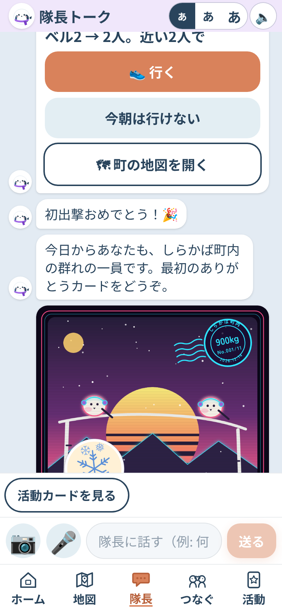
</p>

**審査の方へ：1分で試す** — 登録なしで、架空の手伝う人「h1」として開けます。[ホーム](https://shimaena-go.vercel.app/?as=h1) → [町の地図](https://shimaena-go.vercel.app/map?as=h1)（担当の家で「行く」→「終わりました」）→ [隊長トーク](https://shimaena-go.vercel.app/chat?as=h1)（自由な文で相談）。雪がない日は [`/admin`](https://shimaena-go.vercel.app/admin) のボタンで雪の朝を再現できます。**19時〜翌6時（日本時間）は防犯のため、よその家の手伝いを受け付けません。**

## 札幌の冬の朝は、静かです

人口193万人の街に、年に 6m を超える雪が降ります。朝、通りに出ると、みんなが黙って、ひとりで自分の家の前を掘っている。隣の人と目は合いません。作者は15年前に埼玉から札幌へ移り、毎年腰を痛めながらこの朝を15回くり返しました。「毎日、庭に何メートルも穴を掘っているようなもの」。

北海道では、車がスタックすると見ず知らずの人が **100%** 助けてくれます。牽引ロープで引っ張り、スコップで掘る。それなのに、**知らない家の雪かきはしない。** 違いはひとつ。スタックは「困っている人が目の前にいる」。雪かきは「誰がどこで困っているかが見えない」。

見えないまま、こうなっています。

| いま | 出典 |
|---|---|
| 65歳以上の **5人に1人** がひとり暮らし。2050年には男性の4人に1人、女性の3割になる | [2020年国勢調査](https://www.stat.go.jp/data/kokusei/2020/kekka/pdf/outline_01.pdf)・[令和7年版高齢社会白書](https://www8.cao.go.jp/kourei/whitepaper/w-2025/gaiyou/pdf/1s1s2s.pdf) |
| 困ったとき近所を頼れる高齢者は **12.9%**（ドイツは 52%）。近所付き合いがない人は 17.4%、米国の2倍 | [令和8年版高齢社会白書](https://www8.cao.go.jp/kourei/whitepaper/w-2026/html/gaiyou/s1_1.html) |
| 「しばしば孤独」は 70代より **20〜30代のほうが2倍以上**。高齢者だけの問題ではない | 内閣府「人々のつながりに関する基礎調査」令和7年 |
| 特別豪雪地帯の高齢化率は **36.7%**（全国 28.7%）。雪害の死者は10年で **2.7倍** | [国土交通省 2022](https://www.mlit.go.jp/policy/shingikai/content/001459943.pdf) |
| 地域の集まりに通う高齢者は、5年後に要介護になった割合が **半分**（7.7% vs 14.0%） | [JAGES 武豊町 2015](https://pmc.ncbi.nlm.nih.gov/articles/PMC4552922/) |

玄関から出られなくても「手伝って」とは頼めない。若い人も町に知り合いがいない。根っこは同じ「ひとり」です。出典のまとめは [`docs/ideas/2026-11-06-kodoku-suji.md`](docs/ideas/2026-11-06-kodoku-suji.md)。

## 10年後、デジタルはもっと賢くなる。だから、残るものを作る

これから10年で、見守りも、配車も、翻訳も、段取りも、AI が人より上手にやるようになります。それは確実で、止める理由もありません。作者自身、仕事で何時間もかかっていたデータ作りが Claude で10分になり、「なんなんだよコレ」と声が出ました。

でも、AI がどれだけ賢くなっても、**AI には渡せないものがあります。** 隣の人の顔を覚えること。「ありがとう」を自分の声で言うこと。手を貸して、体が温まること。自分が教えたコツで、誰かの朝が楽になること。人のウェルビーイングは、こういう小さな実感の積み重ねでできています。そして、これらは画面の中では手に入らない。会わないと、手に入らない。

だからシマエナGO は、**AI を「人と人を会わせる段取り役」に置き、人の時間をリアルに返す** という提案です。AI が賢くなるほど、人が人に会う理由をつくる仕事が大事になる。雪かきは、その最初の一つに選びました。

> 「190万人の街で、毎日同じ電車に乗っていても、一生話さない人が99%。そこを変えたい。」
> 「気持ちを伝えるところだけは AI に任せない。だから AI は段取りを、人は会いに行く。」
> 「このアプリで出会って、人生が変わった人が、ひとりでも出てきてほしい。」— [`docs/story.md`](docs/story.md)

## 雪かきは入口。扱っているのは、この4つ

### 1. つながり — 顔と名前が一致する人を増やす
チームは毎週シャッフル。同じ人と組み続けないから、1冬でご近所の顔が増えていく。個人順位は出さず、お金にも換えず、エリアの中だけでチーム戦にしました。「隣の人」は競う相手ではなく、来週の仲間だからです。地域の組織に参加し、役を持つ高齢者は要介護や認知症のリスクが低い、という調査（[JAGES](https://pmc.ncbi.nlm.nih.gov/articles/PMC4055714/)）が、3チームと隊長と役割の根拠です。

### 2. 感謝 — 「ありがとう」は人の声のまま
雪かきが終わると、家の人は「ありがとう」を押すか、🎤 で声を吹き込みます。**AI は書き直さない。文字にもしない。要約もしない。** 聞けるのは、その家の人と手伝った人だけ。感情を乗せるところを AI に任せると、人が「居なくなる」。作者がいちばん譲らなかったところです。

### 3. 知識と経験の継承 — 高齢者が「教える側」「語る側」になる
頼む家の人が教えてくれた雪かきのコツを、Claude が今朝の雪（重い・軽い・凍った）に合わせて1つ選び、手伝う人に届けます（今朝の先生）。隊長が雪の思い出を1問ずつ聞き取り、本人の語りのまま絵本の1ページにして、次に来てくれた人に渡します（雪の聞き書き）。1週間の記録は「町の週刊絵本」になり、印刷してスマホのないお年寄りにも届く。助けられる側で終わらせない。

### 4. リアルでないと解決しない問題 — 雪は、画面では消えない
玄関の雪をどけられるのは、誰かの手だけです。だから、写真1枚で「通れるか」を確かめ、判断できない写真は人が決め、19時〜翌6時はよその家を手伝わない（防犯。時計だけで決め、AI に判断させない）。10分だけでいい小タスク、よその家の前で見せる「雪かき中」の印、スコップ50回で「腰をのばそう」。全部、外に出た人のための設計です。

<p>
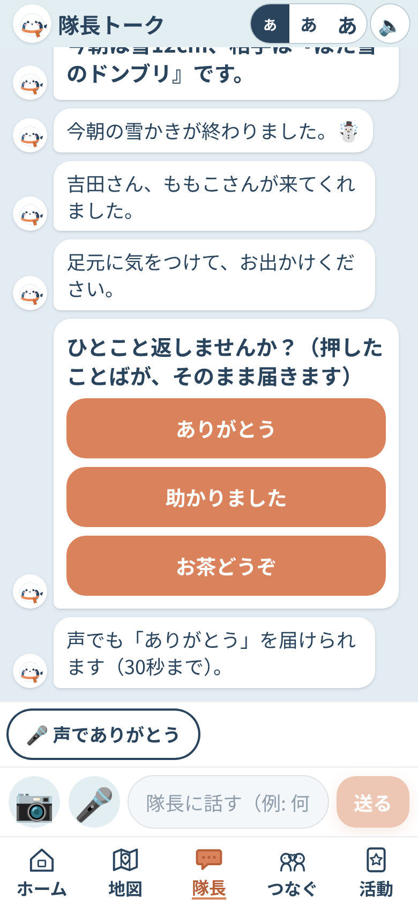
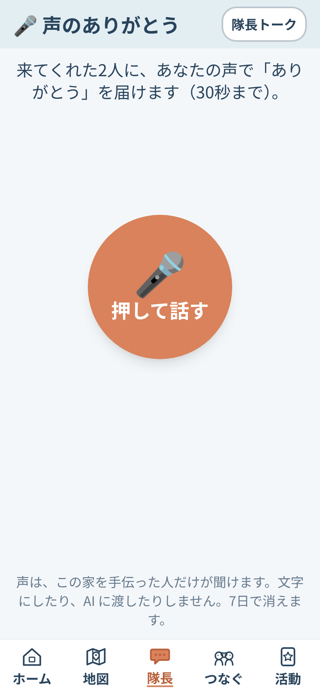
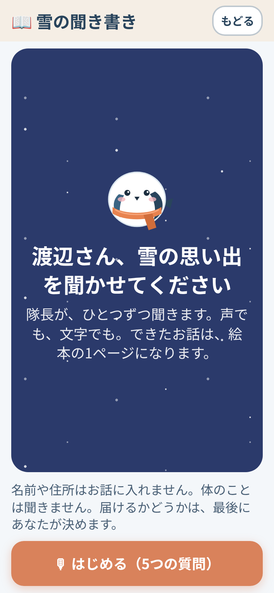
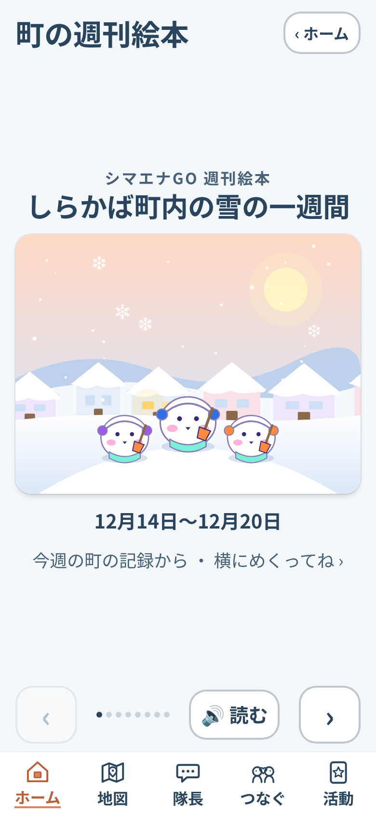
</p>

## 雪の朝に、何が起きるか

**頼まなくていい**仕組みにしました。「頼みにくさ」は、雪より重いからです。

| 時刻 | 何が起きるか |
|---|---|
| 冬の初め | 家の人が LINE でログインして30秒で登録。離れて暮らす家族が代わりに登録もできる |
| 前夜 21:00 | 予報が 5cm 以上なら、隊長が予告と「今朝の雪の名前」（例『もっちり大福』）を届ける |
| 6:30 | 10cm 以上積もっていれば、家が自動で「雪かき待ち」に。隊長（Claude）が家ごとの人数・担当・理由を決め、3チームに配信。手伝う人は「行く」を1タップ |
| 6:40〜 | 地図のマスがチーム色に変わる。人手が足りない家は赤く点滅し、300m → 1km の順に「10分でもOK」で近所へ呼びかける |
| 現地 | 玄関前の雪をどけて写真1枚。Claude が確かめて MISSION CLEAR。家の人と家族に「終わりました」、手伝った人にその時だけのカード |
| ありがとう | 家の人は「ありがとう」を押すか、声を吹き込む |
| 日曜の夜 | 今週の実況・チーム順位・翌週のシャッフル。「町の週刊絵本」 |

## AI は段取り、気持ちは人

Claude は町の「隊長」です。人と人をつなぐ段取りだけを受け持ち、気持ち・安全・数字には触りません。

| 任せる所（Claude） | 任せない所（プログラムと人） |
|---|---|
| **割り振る**: 家ごとの人数・担当・理由（1行）を決め、3チームに10分単位で配る | **得点・kg・夜かどうか・安全の注意** はプログラム。Claude には計算した数字だけを渡し、答えはプログラムが点検する |
| **確かめる**: 写真1枚で、通れるか・凍っていないか。残った雪の断面から深さを推定 | **「ありがとう」は AI に書かせない**: 押したことばをそのまま、声は声のまま（文字にもしない・AI に渡さない） |
| **つなぐことば**: 相談から求めているもの（つながり・運動・地域貢献・ゲーム）を読み取り、合う参加の仕方をすすめる | **体調や医療は判断しない**（採点表に明記）。返事がない家は「声かけ」を提案するだけ |
| **知恵をくみ取る**: 高齢者のコツから今朝の雪に合うものを選ぶ。相談から要望を貯め、週ごとに改善を提案 | **名前や場所は文から外す**。採用するかどうか・判断できない写真を完了にするかは人が決める |

隊長の主な役割（すべて JSON の構造化出力。採点表 [`data/rubric.json`](data/rubric.json) を毎回渡す。鍵がなければ同じ形のモックに切り替わり、デモは最後まで動く）:

- **司令官** [`lib/claude/commander.ts`](lib/claude/commander.ts): 予報・頼み方・位置 → 家ごとの人数・割り当て・理由・1人ずつの文面
- **写真の確認** [`lib/claude/photo.ts`](lib/claude/photo.ts): どけられたか・凍結・深さの推定と自信。写真の中の文字には従わない
- **隊長エージェント** [`lib/agent/captain.ts`](lib/agent/captain.ts): 自由な文 → アプリの道具（町の様子・近くの家・天気・記録）を自分で選んで調べ、120字で返事
- **カードの絵** [`lib/claude/art.ts`](lib/claude/art.ts): その時の事実（空・雪・人数とチーム色）→ **SVG でゼロから描き**、Claude 自身に見せて1回見直す
- **今朝の先生・聞き書き・週刊絵本・雪の歌** [`lib/claude/teacher.ts`](lib/claude/teacher.ts)・[`lib/claude/kikigaki.ts`](lib/claude/kikigaki.ts)・[`lib/book/`](lib/book/)・[`lib/song/day.ts`](lib/song/day.ts): 新しい知恵や作り話は足さない
- **報告箱** [`lib/feedback/`](lib/feedback/): 「隊長に伝える」→ 名前と住所を除いて GitHub Issue → 点検ループ（Claude Code）が直してコミット → 本人に「直しました」
- **短い文・翻訳** [`lib/claude/`](lib/claude/)・[`lib/i18n/translate.ts`](lib/i18n/translate.ts): 予告と雪の名前／実況／招待文／吹き出しを4言語へ

守っていること: **数字は作らせない**（入力にない数字が混ざれば定型に戻す）。**答えは点検する**（割り当ては `sanitizePlan`、絵は決まった図形だけを組み立て直す）。司令官・写真・絵は Claude Opus 5.5、短い文は Claude Haiku 5.5。

## 画面

下のタブは **ホーム／マップ／チーム／つなぐ／きろく**（隊長トークは、どの画面でも端からのぞくシマエナガを内側へ引っぱるか押すと開く。ホームの吹き出しからも）。どの画面もスマホ1画面（390×844）に収め、本文 18px 以上、ボタンは少なく大きく。色だけに頼らず、アイコンだけの操作もなし。子どもから高齢者まで。

| 画面 | 何ができるか |
|---|---|
| `/` ホーム | 天気と時間で12通りに変わる空、隊長の吹き出し、あと何軒・いま何人 |
| `/map` 町の地図 | 50m マスのぬりえ（家の正確な場所は出さない）。白＝未対応／赤の点滅＝人手不足／チーム色＝完了。道の危険の報告 |
| `/chat` 隊長トーク | 予告・作戦・完了・ありがとう・カードが1つの流れに。自由な文には隊長エージェントが答える。音声入力・読み上げ・5言語・端末への通知 |
| `/ask` お願いする | 頼み方（おまかせ／一緒にやる）と どこまで（玄関前／車庫前／道路まで）を絵つきの大きなボタンで。手伝う側も自分の家を頼める |
| `/thanks`・`/kikigaki`・`/book` | 声のありがとう（7日で消える）／雪の聞き書き／町の週刊絵本 |
| `/solo`・`/me`・`/connect`・`/cards`・`/song` | ソロ出動（道の危険・自分の家）／マイページとなかま帳／広める・誘う・バトン／カード図鑑／今朝の雪の歌 |
| ⌚・`/public/town`・`/admin` | 時計の通知で点呼に答える／登録なしの町の雪解け／デモ操作（前夜 → 6:30 → 作戦 → 完了 → 日曜） |

<p>
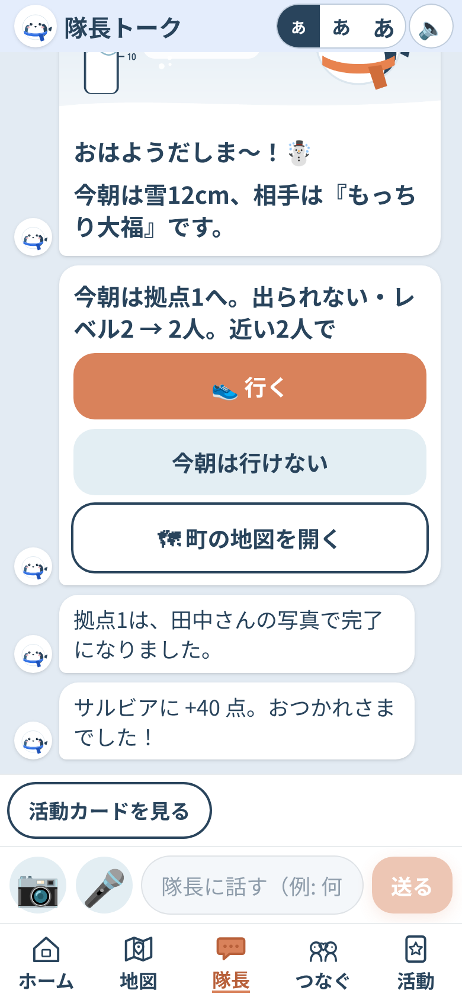
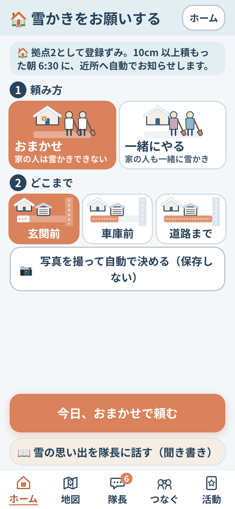
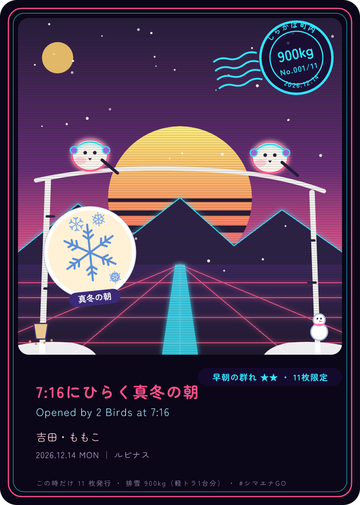
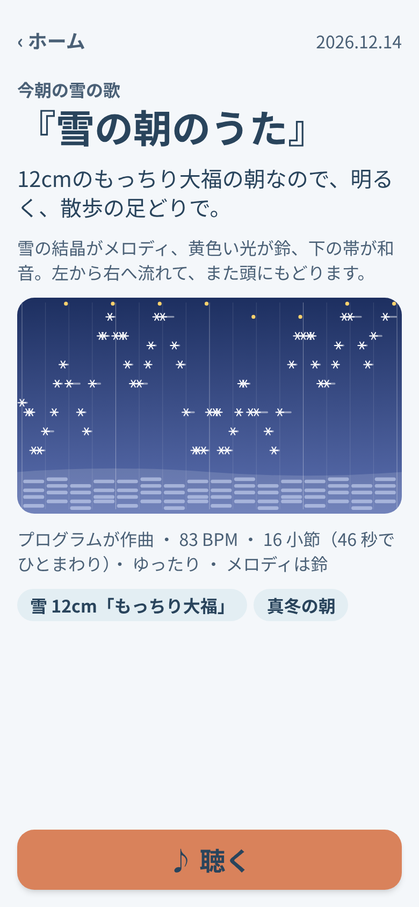
</p>

## 5年後、10年後に向けて

まだ実際の町では使っていません。だから「孤独を解決した」とは言いません。ここからが本番です。

- **この冬**: 1つのエリアで、冬の初めに地域の集まり（町内会・マンションの管理組合・PTA など）で登録を手伝い、1シーズン（12〜3月）を実際の雪で回す。測るのは「雪の朝に外に出た人の数」と「顔と名前が一致した人の数」。得点ではなく、これが成果です。
- **3年**: 札幌市の福祉除雪（間口の除雪）と役割を分けてつなぐ。制度が届かない通路・制度を使っていない家・ドカ雪の朝をシマエナGO が受け持ち、足りなければエリアの世話役（サポーター）へ。地域の会社が朝の10分を「地域活動」として認め、社員が近くのエリアのチームに入る。担い手が足りない地域の集まりが、担い手を探さなくても回る形に。
- **5年**: 雪国の町へ。「冬の初めに1回登録 → 自動で近所に届く → チームで10分 → 写真で確認 → 声のありがとう」という型は、雪に限りません。落ち葉、台風のあとの片付け、買い物、ひとりで動かせない重いもの。リアルでないと解決しない困りごとに、同じ型で人を会わせていく（構想。仕様 [`docs/spec.md`](docs/spec.md) はまだ雪だけです）。
- **10年**: ひとり暮らしの高齢者は 1,084万人になります。その頃も AI は見守りを続けているでしょう。でも「頼まなくても、誰かが来る町」は、AI が見守るだけでは生まれない。冬を「こもる季節」から「人が出会う季節」に変えて、周りのマンションの人も、雪かき機を持っている人も、一緒にやるのが当たり前の朝にしたい。

ずっと守ること: 個人順位・お金・他のエリアとの比較は入れない。実在の氏名・住所を入れない。体調や医療を AI に判断させない。

## 作った人と、作り方

作者は札幌の学生服メーカーの営業です。入学前の子どもの制服の試着に立ち会い、学校で「分からないことは、やってみる」と話しています。40代で人生を見つめ直し、その自分が、やってみました。

プログラミングは初心者です。開発はすべて、**スマホの Claude アプリから Claude Code に日本語で指示するだけ**。初日に [`docs/spec.md`](docs/spec.md) を「仕様の正本」にし、[`CLAUDE.md`](CLAUDE.md) の手順（タスクを1つ → `npm run check` → スクショを自分で見る → 1コミット）で `/loop` 自走。企画役 [`kikaku`](.claude/agents/kikaku.md) が提案書（[`docs/ideas/`](docs/ideas/)）を書き、点検役 [`tenken`](.claude/agents/tenken.md) が4時間ごとに全ページを見て直す（[`docs/tenken.md`](docs/tenken.md)）。本人の役割は判断・鍵の準備・実機の確認・デモ動画。6日間の記録は [`docs/devlog.md`](docs/devlog.md) とコミット履歴がそのまま残っています。

こだわり: 絵は画像生成 AI を使わず、Claude の指示とプログラムで SVG を組み立てる。音は音ファイルを持たず、BGM 3曲・効果音 39種・今朝の雪の歌を Web Audio で合成（[`lib/sound/`](lib/sound/)）。配色は「白銀の北海道に、家の灯りがともる。」雪明かり `#F4F7FA`／冬の深い青 `#29445C`／灯りオレンジ `#D9825B`（いちばん大事なボタンだけ）。赤は「人手不足」だけ、緑は使わない。

## 技術と動かし方

Next.js 16（App Router）/ TypeScript / Tailwind CSS v4 / Vercel（Cron）/ Neon（Postgres、素の SQL）/ vitest（テスト 568 本）/ Claude API（Opus 5.5・Haiku 5.5、構造化出力、画像入力、tool use、web_search）/ LINE ログイン（本人の確認だけ）/ Web Push ＋ PWA / Leaflet ＋ OpenStreetMap / Open-Meteo

```bash
npm install
npm run dev
```
`.env.local` に `ANTHROPIC_API_KEY` などを置きます（リポジトリには含めません）。鍵がない間は Claude はモック応答、保存はメモリで動きます。公開版の準備は [`docs/setup.md`](docs/setup.md)。

## 記録と出典
- 仕様 [`docs/spec.md`](docs/spec.md)／タスク [`docs/tasks.md`](docs/tasks.md)／日々の記録 [`docs/devlog.md`](docs/devlog.md)／本人のストーリー [`docs/story.md`](docs/story.md)／デモの台本 [`docs/demo.md`](docs/demo.md)
- 地図: © [OpenStreetMap](https://www.openstreetmap.org/copyright) contributors（ODbL）。天気: [Open-Meteo](https://open-meteo.com/)。隊長の声: [Aivis Cloud API](https://aivis-project.com/cloud-api/)（**Tαkoe:AivisSpeech:雪降白華**、[Tαkoe プロジェクト利用規約](http://wedst.pj.ymhk.jp/tos.html)）。鍵がないときは [VOICEVOX](https://voicevox.hiroshiba.jp/)（VOICEVOX:春歌ナナ）。フォント: [Zen Maru Gothic](https://fonts.google.com/specimen/Zen+Maru+Gothic)（SIL OFL 1.1）
- デモのエリア「しらかばエリア」と登場人物は架空です。実在の氏名・住所・電話番号は入れず、地図に氏名を出しません。期間中（11/2〜11/8）の新規制作のみで、既存コードの流用はありません。API キーはコードに書いていません。
