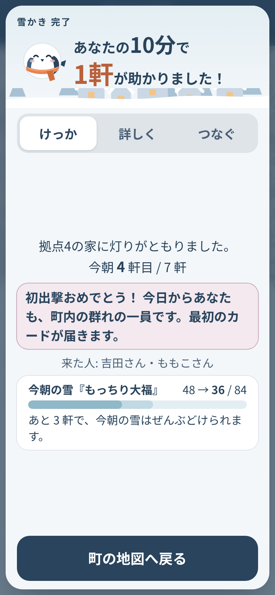
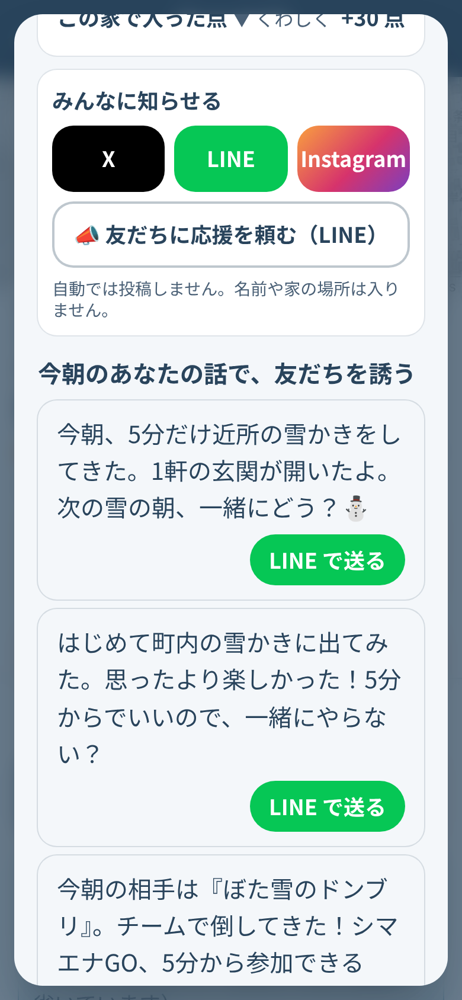
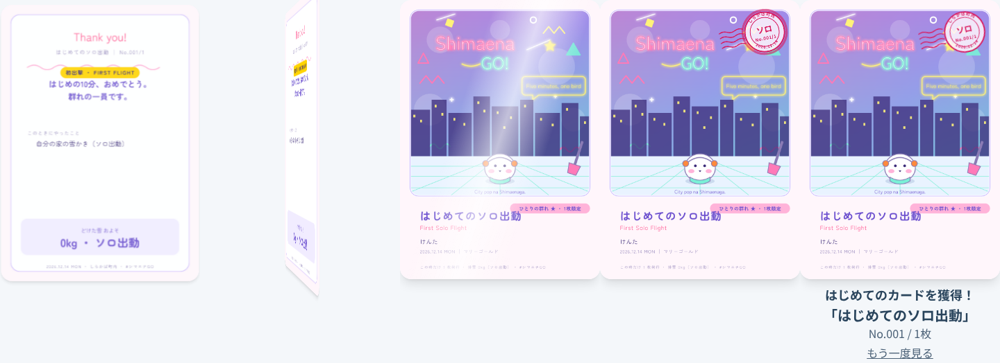
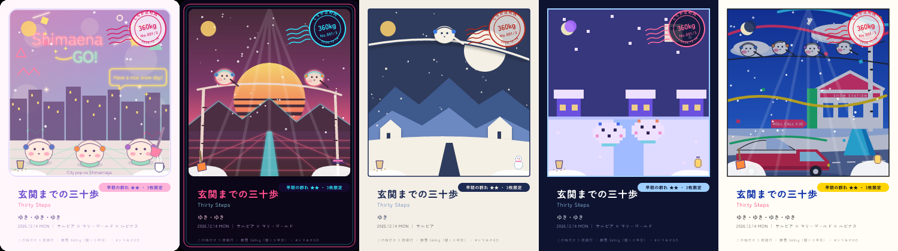
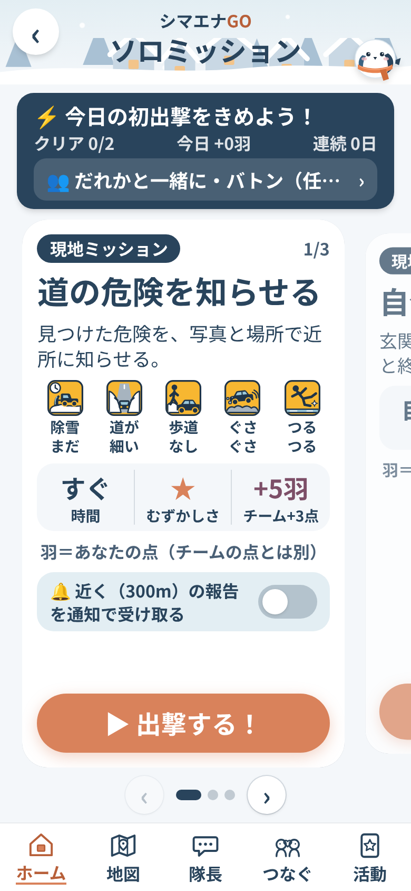
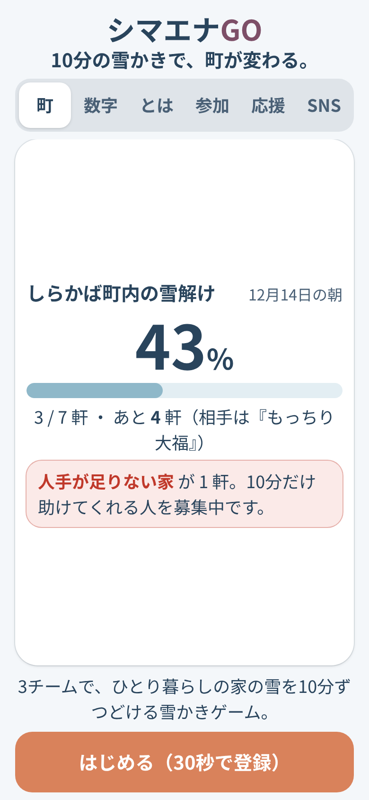
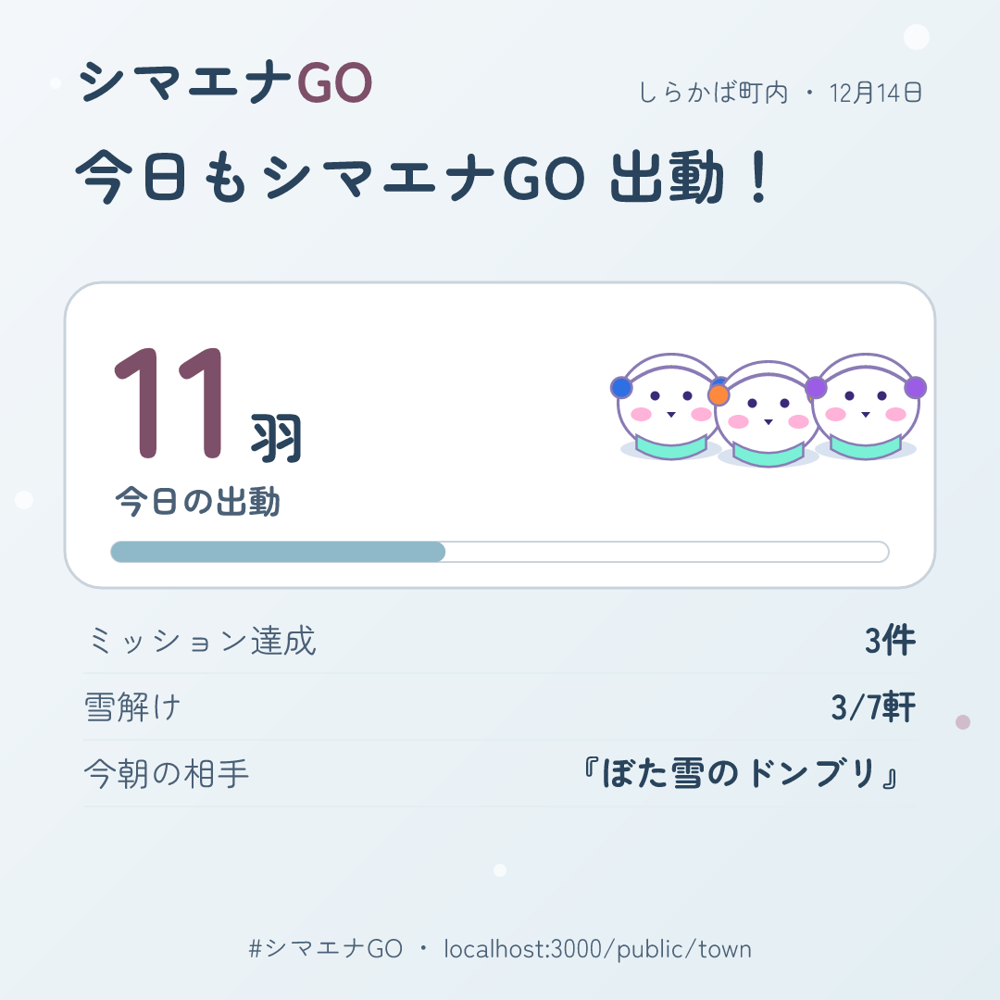
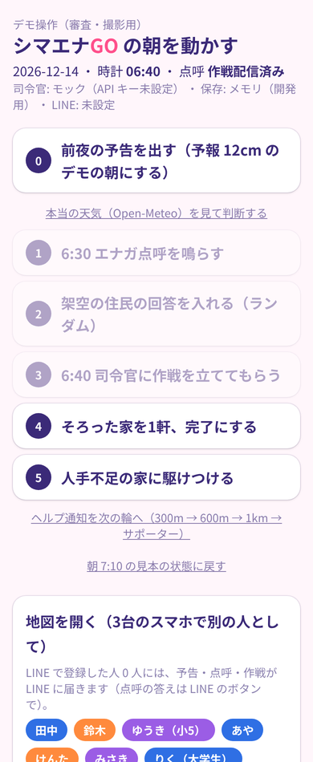

# シマエナGO

**寒い冬は、くっついて乗り切る。**

雪の朝にアプリの「隊長トーク」へ点呼が届き、町内のランダム3チームが、ひとり暮らしの家の雪をどける。
朝だけでなく **6〜19時ならいつでも**、自分の時間で10分から。参加するほど、その時だけのカードが増えていく雪かきゲームです。

Built with Claude: Japan 2026（Anthropic × Cerebral Valley 主催）提出作品。
**11月2日〜11月8日の期間中に、このリポジトリ上でゼロから制作しています。**

<p>



</p>
<p>



</p>
<p>



</p>

## 公開中のアプリ
- https://yukikaki-karano-kaihou.vercel.app/

| 画面 | 何ができるか |
|---|---|
| `/` ホーム（きょうの町） | 見る・動くところ。隊長の吹き出し（状態別のひとこと）、天気と時間で変わる空、今日の雪と次に起きること、あと何軒・いま N人 雪かき中、今週のあなたのチーム、大きなボタン（出動する／ソロ活動をする）、あと1人で救える家、応援・おつかれさま。夜は「近隣の雪かきは明日6時から」と自宅の雪かきだけ。下のタブ: ホーム／地図／活動／使い方 |
| `/map` 町の地図 | 50m マスのぬりえ。3チームの得点バーと今朝の雪（雪ボス）のHP、全軒完了で「討伐」。ログインした本人には自分の割り当て・司令官の理由・今朝の先生のコツ・「行く」「終わりました（写真）」「人手が足りない」。完了すると MISSION CLEAR（点の内訳・Claude が写真で見たこと・雪の深さの推定）。「10分だけ助けに行く」、道の危険のピン（24時間）、ソロの足あと、「結果をコピー」 |
| `/solo` ソロ出動 | 仲間がいなくても1人で。ミッションは2つ: **道の危険を知らせる**（種類・写真・位置）と **自分の家の雪かき**（Before／After の写真 → どけた雪 ○kg と自慢の画像）。毎回カードが1枚。近くの道の報告の通知のオン・オフ |
| `/cards` 活動カード | 今日の活動（羽・連続出動・カードの枚数・今日やったこと）、集めたカードのゲージ、次のご褒美まで |
| `/cards/book` カード図鑑 | その時だけのカード。正方形と 4:5 で保存。図鑑（5タッチ・リボン・今週の称号）と、ご褒美（想定。架空の地元の銭湯・お店） |
| `/team` 今週のチーム | 今週のチームの色とチーム色のマフラーのシマエナガ・期間・人数（名前は出さない） |
| `/today` 今朝のようす | 今日のあなた・雪のこり・チームの得点・実況・応援・今日のカード・SNS に投稿・友だちを誘う |
| `/rules` 使い方 | 触って覚えるチュートリアル（6枚のスライド）。隊長トークの練習、最後に「はじめる」。持ちもの・けがをしないため・点数などは開け閉めできる項目で |
| `/settings` 設定 | 登録の確認・やり直し |
| `/public/town` 公開ページ | 登録前でも見られる町の雪解け（集計だけ）。町を応援する・はじめる・シマエナ診断。招待リンクから開くと「友だちから、雪かきのお誘いが届きました」 |
| `/public/diagnosis` シマエナ診断 | 登録なしの5問で「あなたは何シマエナ？」。結果カードを SNS でシェア |
| `/admin` デモ操作 | 前夜の予告 → 点呼 → 回答 → 司令官 → 完了 → 駆けつけ → お昼・夕方の出番 → 日曜のまとめ、をボタンで。DB の準備、問題の記録、今週の「声」と改善の提案も |
| `/chat` 隊長トーク（v1.17） | 知らせる・相談するところ（LINE の代わり）。点呼、作戦、「行く」、写真で完了、ヘルプ通知、雪かきを頼む、隊長に相談（よくある質問と AI参加コンシェルジュ。4つの方向でマッチング）、道の危険の通知、カード、家族への通知と応援スタンプ、ありがとう点呼。端末への通知（Web Push）つき |
| `/login`・`/start` | LINE でログイン（本人の確認だけ）→ 画面で30秒の登録（手伝う／手伝ってほしい／家族の代わりに → 家の場所 → 2問）。連携コードも画面で |

## デモ動画
（3分・日本語。提出時に URL を記入。台本は [`docs/demo.md`](docs/demo.md)）

## 誰の、どんな課題を、どう解決するか
- **誰の**: 札幌の一軒家にひとりで暮らす高齢者。雪の朝、玄関から道路まで出られない。
- **どんな課題**: 近所に頼みたくても頼みにくい。手伝える人がいても、誰がどこで困っているか分からない。雪かきは早朝の重労働で、「ありがとう」だけでは人が集まらない。
- **どう解決するか**: 雪の朝に隊長トークへ1問だけの点呼（端末に通知）。「いいえ」の1タップで、Claude が近所のチームに10分単位の小さな仕事として割り振る。朝に間に合わなくても、6〜19時ならいつでも「雪かきを頼む」「出動する」ができる。地図が塗られていき、動いた人にはその時だけのカードが届く。
- **お互いさま**: お願いする側もチームに入り、元気な日は雪かきに出られる。1人でも「自分の家の雪かき」や「道の危険を知らせる」で参加でき、チームの得点になる。

## 1日の流れ（v1.10）
| 時刻 | 何が起きるか |
|---|---|
| 前夜 21:00 | 翌朝6時までに 5cm 以上の予報なら、隊長が予告と「今朝の雪の名前」 |
| 6:30 | 点呼（1問）。お願いする側「玄関は出られそう？」はい／いいえ／一緒なら。手伝う側「今日いつ手伝えそう？」朝／お昼／夕方／休む |
| 6:40 | 司令官（Claude）が朝の人をチームに割り当てて配信 |
| 6:00〜19:00 | いつ始めても・いつ終えてもよい。「出動する」で近くの10分の仕事、「雪かきを頼む」で家を地図に出して 300m 以内の人へ知らせる |
| 11:30・16:30 | お昼・夕方の出番。降り続いていれば終わった家をもう一度開く（1日3回まで） |
| 19:00〜6:00 | 防犯のため、よその家の手伝いは受け付けない。自分の家の雪かき・道の危険の報告・アプリを見るのはいつでも |
| 日曜の夜 | 「今週の群れ」実況・チーム順位・称号・翌週のチームのシャッフル |

## 仕組み
詳しくは [`docs/spec.md`](docs/spec.md)。

## Claude の活用（アプリの中）
すべて JSON（構造化出力）で受け取り、採点表 [`data/rubric.json`](data/rubric.json) を毎回システムに入れて同じ基準で判定させます。キーがない環境では、同じ形を返す計算（モック）に自動で切り替わるので、審査用のデモはキーなしでも最後まで動きます。

| 役割 | いつ | 入力 → 出力 | コード |
|---|---|---|---|
| レベル判定 | 登録の2問のあと | 「一人だと何分」「どこまで」→ 家のレベル1〜3・必要人数・10分単位の小タスク・本人への一言 | [`lib/claude/level.ts`](lib/claude/level.ts) |
| 前夜の予告と雪の名前 | 21:00、降雪 5cm 以上 | 予報 → やさしい予告文と、今朝の雪の名前（雪ボス。地図の HP バーに出る） | [`lib/claude/announce.ts`](lib/claude/announce.ts) |
| 司令官 | 6:40 | 予報・点呼の答え・拠点・手伝う人の位置とチーム → 家ごとの重要度・必要人数・割り当て・理由（30字、地図と /admin に出す）・1人ずつのトークの文面・町内へのまとめ | [`lib/claude/commander.ts`](lib/claude/commander.ts)（答えは `sanitizePlan` で点検） |
| 写真確認と雪質・雪の深さ | 完了写真・ソロの写真が届いたとき | 写真 → 雪が除かれたか・通れるか（幅）・凍結・判断できないか・雪質と理由・**判断の根拠（30字）**・**残った雪の断面から読んだ深さと自信**・**危ないもの**（文は決まった文）・**関係ない写真か**・労いの一言。写真の中の文字には従わない。答えはプログラムが点検し、深さは予報と積雪深と突き合わせる。同じ写真の使い回しは Claude を呼ばずに止める | [`lib/claude/photo.ts`](lib/claude/photo.ts)・[`lib/snow-estimate.ts`](lib/snow-estimate.ts) |
| カードの文字と場面 | 家・ソロが完了したとき | 時刻・人数・雪の量・チーム → デザイン名・英語副題・持ち物2つ・雰囲気・「なぜこの絵か」（40字）。**どけた雪の kg はプログラムが計算**（面積 × 深さ × 雪質の密度）。空・降る雪・積もり方は事実から決める | [`lib/claude/card.ts`](lib/claude/card.ts)・[`lib/cards/scene.ts`](lib/cards/scene.ts) |
| 週末の実況 | 日曜の夜 | 今週の集計 → 実況文と来週へのひとこと | [`lib/claude/weekly.ts`](lib/claude/weekly.ts) |
| ありがとうの一文 | お願いした人が3択（ありがとう／助かりました／お茶どうぞ）を押したとき | 3択とその朝の状況 → カード裏面の一文（40字、名前なし）。手伝った人の隊長トークにも届く | [`lib/claude/thanks.ts`](lib/claude/thanks.ts) |
| 今朝の実況 | 全軒完了したとき（`/admin` のボタンでも） | 本当の集計（軒数・動いた人数・時刻・合流・駆けつけ）→ 3〜4文。数字は Claude に作らせない | [`lib/claude/recap.ts`](lib/claude/recap.ts) |
| SNS の投稿文 | 家・ソロの完了と今朝の実況のあと（返事を返してから） | 公開用の集計（人数・軒数・雪解け率）→ 115字の下書き。入力にない数字が混ざれば定型に戻す。本人が直して自分で投稿（自動投稿しない） | [`lib/claude/share.ts`](lib/claude/share.ts) |
| ソロ出動のひとこと | ソロのミッションを終えたとき | ミッション・羽・連続日数 → 30字（SOLO CLEAR と個人の活動カード） | [`lib/claude/solo.ts`](lib/claude/solo.ts) |
| **AI参加コンシェルジュ**（隊長に相談） | 隊長トークの自由な文（何でもよい。往復の上限なし）、「出動する」で近くに家がないとき | 文と、その人に開いている参加の方法（プログラムが絞った候補）→ その人が求めている方向（つながり・運動・地域貢献・ゲーム）を読み取って残し、合う1つを選ぶ・2文の返事と理由の1文・その人用の画像の場面（空・ひとこと）。体・危ない作業のことばは Claude を使わず決まった返事。夜はよその家をすすめない |
| **声を貯めて改善**（v1.17） | 相談の1往復ごと／日曜の夜 | 相談から「求められていること」（機能の要望・分からない所・困りごと・うれしい声）を要約で貯め、1週間ぶんから改善の提案 3〜5件（題・件数・直し方・仕様のどこ・優先）。採用は本人が決める | [`lib/claude/improve.ts`](lib/claude/improve.ts)・[`lib/voice/`](lib/voice/) | [`lib/claude/concierge.ts`](lib/claude/concierge.ts)・[`lib/concierge/`](lib/concierge/) |
| ことばで答える・頼む | 点呼の時間に、ボタンの代わりにふつうの文が届いたとき | 「10時に病院だから、9時までに玄関だけ」→ 答え・締め切り・範囲・手伝う人へのひとこと（病名や体のことは書かない）。原文は保存しない | [`lib/claude/words.ts`](lib/claude/words.ts) |
| 隊長のひとこと | 作戦の時に1回だけ（状態ごと） | 状態（はじめて・あと1軒・しばらくぶり など。状態は計算で決める）→ ホームの吹き出し2行 | [`lib/claude/captain.ts`](lib/claude/captain.ts) |
| 今朝の先生 | 作戦の時 | お願いする側が教えてくれた雪かきのコツから、今朝の雪に合うものを1つ選び25字に整える（新しい知恵は作らない） | [`lib/claude/teacher.ts`](lib/claude/teacher.ts) |
| あなたが主役の招待文 | 家・ソロの完了画面 | その人の今朝の本当の出来事（kg・カード名・ありがとう・雪の名前）→ 送る相手別の3案（友だち・家族・職場や学校）。名前・場所・作った数字は点検で外す | [`lib/claude/invite.ts`](lib/claude/invite.ts) |
| 休みのひとこと | ホーム | 天気・気温・風と今日の出動回数 → 「休みながら」の1文（体調の判断はしない） | [`lib/claude/rest.ts`](lib/claude/rest.ts) |
| 診断のひとこと | シマエナ診断の結果（タイプごとに1日1回） | タイプ → 40字のひとこと | [`lib/claude/quiz.ts`](lib/claude/quiz.ts) |

- **AI の基準**: 状態の判定・夜かどうか・安全注意を出すか・得点・kg は普通のプログラム。Claude は人のことば・写真の読み取りと、文を書くところだけ。数字は計算した値だけを渡す。
- **モデルの使い分け**: 司令官・写真・ことばの読み取りは Claude Opus、短い文（隊長のひとこと・今朝の先生・招待文・休みのひとこと）は Claude Haiku。
- 司令官には「シマエナ隊長」という声がある（採点表の voice。世話焼きで明るい町内会長風。やさしい日本語のまま。判定には影響しない）。
- 体調や医療は判断しない（採点表の safety に明記）。返事がない家は「声かけ」を提案するだけ。
- 絵（カード・リッチメニュー・コンシェルジュの画像・自慢の画像）は画像生成AIを使わず、SVG を図形から組み立てる（[`lib/cards/svg.ts`](lib/cards/svg.ts)）。

## 技術
- Next.js 16（App Router）/ TypeScript / Tailwind CSS v4 / Vercel（Cron）＋ GitHub Actions（6:40・11:30・16:30）/ Neon（Postgres、素の SQL）
- Claude API（Claude Opus 5.5 と Haiku 5.5、構造化出力、画像入力、プロンプトキャッシュ、安全判定で断られたときのサーバー側フォールバック）
- LINE ログイン（Web 版 OAuth、本人の確認だけ）、Web Push（web-push、VAPID）＋ PWA（manifest・service worker）
- Leaflet ＋ OpenStreetMap、Open-Meteo、resvg（SVG → PNG）、vitest（テスト 390 本）
- 音（BGM 3曲と効果音 36 種）は音ファイルを持たず、Web Audio API で全部その場で合成（Claude が音符データで作曲。`lib/sound/`）

## デザイン「白銀の北海道に、家の灯りがともる。」
- 配色は `app/globals.css` の CSS 変数で一元管理: 雪明かり `#F4F7FA`（背景）／冬の深い青 `#29445C`（文字・見出し・ナビ）／灯りオレンジ `#D9825B`（いちばん大事なボタンだけ）／氷の青 `#8FB8C9`（進捗）／雪椿ピンク `#C8A7B8`（達成の演出）／生成り `#F5EEE5`（やわらかい囲み）。赤は「人手不足」と注意だけ、緑は使わない。
- 子どもから高齢者まで: 本文 16px 以上（既定 18px）、ボタンは高さ 56px 以上（操作ボタンは 64px）、アイコンだけの操作はなし、色だけに頼らず文字と形（✓・！・点滅のわく）でも状態を出す。「人手が足りない」は押す前に一度たずねる。
- ホームは隊長の吹き出しと、天気（Open-Meteo）と時間で12通りに変わる空。完了画面は家の窓に灯りがともる演出と、カードが下から上がってめくれ、消印のスタンプが「ドン」と押される演出（動きを減らす設定では止める）。

## Claude Code をどう使ったか（スマホだけで開発）
本人はプログラミング初心者で、開発はすべて **スマホの Claude アプリから Claude Code（クラウド）に日本語で指示するだけ** で進めました。パソコンでコードを書いた時間はありません。

1. **仕様を先に決めた**: 初日に Claude と壁打ちして2案を比べ、[`docs/spec.md`](docs/spec.md) を「仕様の正本」にした。Claude はここに書いてないことを足さず、変えたいときは [`docs/devlog.md`](docs/devlog.md) に「提案」として書いて本人に聞く約束（例: 「建物の形を塗る」→ 50m マスに変更）。
2. **ループで自走**: [`CLAUDE.md`](CLAUDE.md) に「1回のループで [`docs/tasks.md`](docs/tasks.md) の未完了の一番上のタスクを1つだけ進める → `npm run check`（lint・型・テスト・build）→ スマホ幅のスクショを自分で見て確認 → 1タスク1コミットで push → devlog に3行」という手順を書き、`/loop` で T01 から T70 まで自走させた。鍵（LINE・Neon）が要るところはボタンや環境変数にして、鍵のないセッションでも本番と同じコードが動く形にした。
3. **本人の役割**: 判断（仕様・デザインの選択）、鍵の準備（LINE Developers・Neon・Vercel の環境変数）、実機での確認、デモ動画。Claude Code からの報告は毎回3行以内（できたこと・見てほしいもの・次）にして、スマホで読める量に。
4. **企画役のエージェント**: [`.claude/agents/kikaku.md`](.claude/agents/kikaku.md) に「コードは変えず、面白さ・広がる仕組みを調べて提案書を書く」役を置いた。
5. **記録はすべて公開**: 日ごとの [`docs/devlog.md`](docs/devlog.md)、タスクの順番 [`docs/tasks.md`](docs/tasks.md)、見送った案 [`docs/plan-b-nuisho.md`](docs/plan-b-nuisho.md)、カードやアイコンの試作 [`docs/design/`](docs/design/)。コミット履歴がそのまま制作の記録です。

## 開発の記録
- 日々の記録: [`docs/devlog.md`](docs/devlog.md)
- 作業の順番: [`docs/tasks.md`](docs/tasks.md)
- 検討して見送った案: [`docs/plan-b-nuisho.md`](docs/plan-b-nuisho.md) ほか

## ローカルで動かす
```bash
npm install
npm run dev
```
`.env.local` に `ANTHROPIC_API_KEY` などを置きます（リポジトリには含めません）。
鍵がない間は、Claude はモック応答、保存はメモリで動きます。

## 公開版（Vercel）の準備
1. Vercel の環境変数に `DATABASE_URL`（Neon）を入れる。
2. `/admin` を開き「DB を準備する」を押す（表を作り、架空の町内データを入れる。何度押しても安全）。
3. 「保存: Neon（参加者 12 人）」と出れば完了。以後、地図とデモ操作の状態は Neon に保存される。
4. 表が増えたとき（`db/schema.sql` が変わったとき）は、`/admin` にまた黄色い枠が出るので、もう一度押す。

### 管理画面と運用の設定（11/4 追加）
- `ADMIN_PASSWORD`: `/admin`（デモ操作）を開く合言葉。**公開版では入れるまで誰も操作できません。**
- `DEMO_MODE=off`: 本当に町内で使うとき。`?as=h3` のような架空の人として押すことと、「見本の状態に戻す」ができなくなります（既定はオン＝審査・撮影用）。
- `/admin/settings` の「通知を一時停止」で、端末への通知だけを止められます（隊長トークには残ります）。
- `/admin` には、保存や通知の失敗が赤い「問題」として出ます。「声」タブに今週の声と改善の提案が出ます。

### ログインと通知（spec v1.17: LINE はログインだけ）
1. [`docs/login-setup.md`](docs/login-setup.md) のとおり、Vercel の環境変数に `LINE_LOGIN_CHANNEL_ID`・`LINE_LOGIN_CHANNEL_SECRET`・`AUTH_SECRET`（ログインの印の署名）と、`VAPID_PUBLIC_KEY`・`VAPID_PRIVATE_KEY`・`NEXT_PUBLIC_VAPID_PUBLIC_KEY`（端末への通知）を入れる。
2. 「はじめる」→「LINE でログイン」→ 許可 → 画面で30秒の登録（手伝う／手伝ってほしい／家族の代わりに → 家の場所 → 2問 → チーム。お願いする側もチームに入る）。家族は「家族の代わりに登録」→ 6桁の連携コードを本人や他の家族が「はじめる」の画面で入れて紐づける。
3. 隊長トーク（下のタブ「隊長」）の上の「通知を受け取る」で、端末への通知をオンにする（iPhone はホーム画面に追加してから）。鍵がない間は通知は届かず、隊長トークにたまるだけ。

### 一本道（行く → 写真 → 完了）
- 作戦のトークには「行く」「今朝は行けない」のボタンが付く。現地で終わったら、玄関前から道路側を写した写真を1枚 隊長トークか地図から送ると、Claude が確認して完了になり、得点が入り、依頼者に「終わりました」が届く。判断できない写真でも「それでも完了にする」が選べる（AI を最終判定者にしない）。
- 地図はログインした本人の割り当てが出て、下の「行く」「終わりました（写真）」「人手が足りない」が使える。`/map?as=h3` のように架空の人として動かせる（デモ用）。

### ヘルプ通知・雪かきを頼む・見守り
- 人手が足りない家（作戦の時点で不足／現場の「人手が足りない」／作戦のあとの「いいえ」）は、近い順に 300m → 600m → 1km の手伝う側（全チーム）に「10分でもOK」の小タスクを添えて隊長トークで呼びかける。最後は町内会役員役のサポーター（環境変数 `SUPPORTER_LINE_USER_IDS`、LINE のアカウント ID をカンマ区切り）へ。
- **雪かきを頼む**（6〜19時いつでも）: お願いする側が隊長トークの「雪かきを頼む」を押すと、家が今日の「雪かき待ち」として地図に出て、300m 以内の手伝える人へ知らせる（1人1日3回・同じ家は1日1回）。夜は「明日の朝6時から頼めます」。
- 点呼に返事がない家は地図で灰色に点滅し、300m 以内の人に「声かけお願い」、家族に「返事がありません」が届く。体調や医療の判断はしない。
- 家が終わると、依頼者と家族に「終わりました」が届く。

### 夜の防犯ルール
- 19:00〜翌 6:00 は、自分の家の雪かきと家の中でできること（アプリを見る・道の危険の報告・応援）だけ。よその家の「行く」「出動する」「10分だけ助けに行く」は明るい時間に。時計だけで決める（[`lib/night.ts`](lib/night.ts)、AI は使わない）。

### ソロ出動・道の危険・SNS
- `/solo` のミッションは2つ。**自分の家の雪かき**（時間は自由。Before／After の写真から、どけた雪をおよそ ○kg と推定し、手がかりがない日は出さない）と、**道の危険を知らせる**（除雪が来ていない／道が細い／歩道がない／ぐさぐさ雪／凍って転びやすい → 写真 → 位置）。
- 道の報告は地図にピン（24時間、報告した人の名前は出さない）。「受け取る」にした人のうち 300m 以内の人へ通知（1人1日6回まで、近い同じ報告はまとめる、夜の報告は朝 6:30 にまとめて）。受け取るかどうかは登録のあとに隊長が聞く（答えるまではオフ）。
- ソロの現地の活動はチームの得点にも入る（自分の家 +5・道の報告 +3・写真の確認 +2、1人1日 15点まで）。羽ポイントは個人の記録で、順位には使わない。ソロも毎回カードが1枚（隊長トークに届くのは、はじめて・5日連続・ふたりの群れだけ）。
- 公開ページ `/public/town` とシマエナ診断 `/public/diagnosis` は登録なしで見られる（集計だけ）。
- SNS シェアカード `/api/share/<種類>.png` と、自宅の雪かきの自慢の画像（Before／After・kg・カードの 4:5）。「X に投稿」は投稿画面を開くだけ、「画像で共有」はスマホの共有シート。**自動では投稿しない**。

### 仲間を増やす仕掛け
- 完了画面と「ありがとう」が届いたトークに「友だちを誘う」（LINE の「送る」画面を開く）。招待文は送る相手別の3案（Claude が本当の出来事から）。
- 招待リンクには「あなたからの招待」の印（参加者 ID から作る8文字。ID や名前は分からない）。開いた人・応援した人を数えて「あなたの誘いで、2人が見てくれました」と本人に返す。
- 誘った人に羽: 開いてくれた +2・応援してくれた +3・仲間の初出動 +20（チームの得点には入れない）。招待を開いてから登録した人の初出動で、二人に限定カード「ふたりの群れ」。

### ありがとうカード
- 家が完了すると、来た人の数だけカードが発行され、隊長トークに表と裏の2枚が届く。二度と同じカードは発行されない（通し番号 No.○/○、裏に「この時だけの設計図 #xxxx」）。
- 絵は画像生成AIではなく `lib/cards/svg.ts` が図形から組み立てる。基本はかわいいシティポップ、7:30 までの完了で 80s レトロウェーブ、20cm 以上で切り絵、2チーム混成で湾岸ポップ、5日連続でドット絵。その上に「場面の層」（完了時刻の空・降る雪・積もった高さ・持ち物）を重ねる。並ぶシマエナガの数＝来た人数、耳あて＝その人のチーム色、右上に消印（町内名・排雪kg・番号・日付）。
- カード帳は `/cards`（ログインすると自分のぶん。デモは `/cards?as=h3`）。正方形（Instagram）と 4:5（X）で保存できる。PNG 化は resvg と同梱フォント（Zen Maru Gothic、OFL）。

### 日曜の「今週の群れ」とメニュー
- 日曜の夜（21:00 の cron、または `/admin`）に、今週の実況（Claude、キーなしは定型）・チーム順位・称号（3日で「早起きのエナガ」、5日で「朝の群れの主」＋レアカード確定）・週の目標ボーナスを隊長トークで送り、翌週のチームを出撃回数と動ける時間でバランスよく組み直す。家族には「今週は N 回手伝ってもらいました」。
- 下のタブは **ホーム／地図／隊長／活動／使い方**。隊長トーク（`/chat`）＝知らせる・相談する、ホーム＝見る・動く、の役割分担（v1.17 で LINE の公式アカウント・リッチメニュー・LIFF はやめ、LINE はログインだけに）。
- 隊長トークに「雪かきGO！」「雪かきを頼む」「隊長に相談」と送っても動く。「出動する」→ 10／20／30／60分 を選ぶと、近く（1km 以内）の小タスクを1件提案し、ないときは隊長が合う活動を1つすすめる。

### 点呼を自動で動かす（Vercel Cron）
1. Vercel の環境変数に `CRON_SECRET`（長いランダムな文字列）を入れる。ないと `/api/cron/*` は動かない。
2. `vercel.json` の cron が、前夜 21:00 JST に予告（Open-Meteo で翌朝 6:00 までの降雪が 5cm 以上のときだけ。日曜は先に「今週の群れ」）、6:30 JST に点呼を送る。
3. 6:40 の作戦配信と 11:30・16:30 のお昼・夕方の出番は、Hobby プラン（cron は2本まで）の Vercel には置かず、**GitHub Actions**（`.github/workflows/plan.yml`・`later.yml`）から `/api/cron/plan`・`/api/cron/noon`・`/api/cron/pm` を呼ぶ。リポジトリの Settings → Secrets and variables → Actions に `APP_URL`（公開 URL）と `CRON_SECRET`（Vercel と同じ値）を入れる。GitHub の定期実行は数分遅れることがあるので、6:40 以降に点呼の答えが届いたときの自動配信も予備として残している。
4. 同じことは `/admin` のボタンで手動でもできる（デモはこちら）。

## データと素材の出典
- 地図と建物の形: © [OpenStreetMap](https://www.openstreetmap.org/copyright) contributors（ODbL）
- 天気: [Open-Meteo](https://open-meteo.com/)
- フォント（カード・メニューの PNG 用）: [Zen Maru Gothic](https://fonts.google.com/specimen/Zen+Maru+Gothic)（SIL Open Font License 1.1、[`assets/fonts/`](assets/fonts/)）
- 地図の表示: [Leaflet](https://leafletjs.com/)（BSD-2-Clause）、SVG の PNG 化: [resvg](https://github.com/RazrFalcon/resvg)（MPL-2.0）
- デモの町内「しらかば町内」と登場人物は架空です。建物の形だけを OpenStreetMap から借りています（`scripts/build-town.cjs`）。

## ルールの遵守
- 期間中の新規制作のみ。既存コードの流用はありません。
- デモ用データはすべて架空の人物・場所です。
