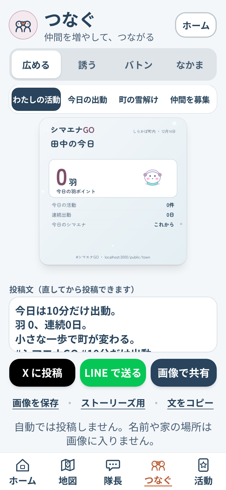

# シマエナGO

**寒い冬は、くっついて乗り切る。**

> 10cm 積もった朝、町内のランダム3チームが、ひとり暮らしの家の雪をどけに行く。
> 雪かきは入口。目的は、町から「ひとり」をなくすこと。

札幌では、車がスタックすると知らない人が100%助けてくれます。でも、知らない家の雪かきはしない。**誰がどこで困っているかが見えないから**です。
シマエナGO は、雪かきをお願いしたい家を「見える」ようにし、ご近所をチームにして、10分単位の仕事として届ける雪かきゲームです。家の人は一度登録するだけ。雪の朝に頼む必要はありません。Claude の「隊長」が家ごとの人数と担当を決め、写真1枚で完了を確かめます。**ただし「ありがとう」だけは AI に書かせず、家の人の声で届けます。** チームは毎週入れ替わるので、知り合いが増えていきます。

- 公開中のアプリ: https://shimaena-go.vercel.app/ （登録なしで見られる [町のページ](https://shimaena-go.vercel.app/public/town)）
- デモ動画（3分・日本語）: 提出時に URL を記入。台本は [`docs/demo.md`](docs/demo.md)
- Built with Claude: Japan 2026（Anthropic × Cerebral Valley 主催）提出作品。**11月2日〜11月8日の期間中に、このリポジトリ上でゼロから制作**しています。

<p>


</p>

## 審査の方へ：1分で試す
- 登録なしで、架空の手伝う人「h1」として開けます: [ホーム](https://shimaena-go.vercel.app/?as=h1) → [町の地図](https://shimaena-go.vercel.app/map?as=h1)（担当の家で「行く」→「終わりました」）→ [隊長トーク](https://shimaena-go.vercel.app/chat?as=h1)（自由な文で相談）。登録も架空の人も要らない [町のページ](https://shimaena-go.vercel.app/public/town) もあります。
- **19時〜翌6時（日本時間）は、防犯のためよその家の手伝いを受け付けません。** その時間はホームに「近隣の雪かきは明日6時から」と出て、地図で「行く」を押しても隊長が「明日6時から」と返します。自分の家の雪かき・道の危険の報告・隊長トークはいつでも動きます。
- 公開中のデータは架空の町（しらかば町内）です。雪がない日は [`/admin`](https://shimaena-go.vercel.app/admin) の「前夜の予告 → 6:30 → 作戦」ボタンで雪の朝を再現できます。

## 30秒でわかるシマエナGO

**困りごと**: 雪の多い大都市・札幌で、高齢者の5人に1人がひとり暮らし。困ったとき近所を頼れる人は8人に1人。雪の朝、玄関から出られなくても「手伝って」と頼めない。一方で若い人も町に知り合いがいない。根っこは同じ「ひとり」。

**しくみ**: 頼む家は冬の初めに1回登録 → 10cm 積もった朝 6:30、自動で近所に届く → Claude の隊長が家ごとに人数と担当を決め、3チームに10分単位で配る → 「行く」→ 現地で写真1枚 → Claude が確認して完了 → 家の人が「ありがとう」を押すか、声で吹き込む → 動いた人に二度と出ないカード、離れて暮らす家族にも「終わりました」。

**ほかと違うところ**
1. **頼まなくていい。** 事前登録と積雪の自動判定で、「頼みにくさ」を仕組みで消す。
2. **お金ではなくチーム戦。** 3色のチームが毎週シャッフル。個人順位は出さず、町内の中だけで競う。
3. **AI は段取り、気持ちは人。** 割り振り・写真の確認・相談は Claude。得点と安全はプログラム。「ありがとう」は家の人の声のまま。
4. **高齢者が「教える側」になる。** 頼む家の人が教えてくれた雪かきのコツを、Claude が今朝の雪に合わせて手伝う人に届ける（今朝の先生）。雪の思い出を隊長が聞き取り、絵本の1ページにする（雪の聞き書き）。
5. **鍵がなくても最後まで動く。** Claude の鍵や DB がない環境でも、同じ形のモック応答とメモリ保存でデモが通る。プログラミング初心者が、スマホの Claude アプリから Claude Code に日本語で指示するだけで6日で作った。

## なぜ雪かきなのか（数字）
- 札幌は人口約193万人の都市なのに、年に 6m を超える雪が降る年がある（[日本気象学会 2014](https://www.metsoc.jp/tenki/pdf/2014/2014_08_0007.pdf)）。一軒家の玄関から道路までの雪は、それぞれの家がどけるしかない。
- 65歳以上の5人に1人がひとり暮らし（[2020年国勢調査](https://www.stat.go.jp/data/kokusei/2020/kekka/pdf/outline_01.pdf)）。札幌の高齢単身世帯は 12.6% → 2040年に 18.7%（[札幌市](https://city.sapporo.jp/kenko/wellness/kenkodukuri/kenkosapporo21/documents/2sho_kenkosapporo3.pdf)）。
- 日本の高齢者は近所付き合いがない人が 17.4%（米国の2倍）、困ったとき近所を頼れるのは 12.9%（[令和8年版高齢社会白書](https://www8.cao.go.jp/kourei/whitepaper/w-2026/html/gaiyou/s1_1.html)）。
- 「しばしば孤独」な人は 70代より 20〜30代のほうが2倍以上多い（内閣府「人々のつながりに関する基礎調査」令和7年）。町内会は担い手が足りない（[札幌市](https://www.city.sapporo.jp/shimin/shinko/chounaikai/hint_top.html)）。
- 北海道の高齢者は冬に出かける範囲が狭まる一方、積雪期は「除雪」と「地域での役割」が外に出る楽しみや自信につながる（[杉田ほか 2024](https://www.jstage.jst.go.jp/article/jjccpt/3/0/3_JJCCPT22016/_article/-char/en)・[原田・村松 2020](https://kaken.nii.ac.jp/ja/grant/KAKENHI-PROJECT-17H07037)）。**雪かきは、冬に外へ出る理由になる。**

数字の出典のまとめは [`docs/ideas/2026-11-06-kodoku-suji.md`](docs/ideas/2026-11-06-kodoku-suji.md)。まだ実際の町では使っていないので「孤独を解決した」とは言いません。めざすのは「会う理由をつくる」ことです。

## 雪の朝のストーリー
登場人物はすべて架空です。小林さん（ひとり暮らし・拠点7）、田中さん（近所の手伝う人・サルビアチーム）、小林さんの娘さん（離れて暮らす家族）。

| 時刻 | 何が起きるか | 誰が・何をするか |
|---|---|---|
| 冬の初め | 小林さんは LINE でログインして30秒で登録。「おまかせ（家の人は雪かきできない）」「玄関前」を選ぶ。娘さんは「家族の代わりに登録」で連携コードを入れる | 登録は1回だけ。毎朝の返事は要らない |
| 前夜 21:00 | 予報が 5cm 以上なら、隊長が予告と「今朝の雪の名前」（例『もっちり大福』）を届ける | なし |
| 6:30 | きのう 6時〜今朝 6時に 10cm 以上積もっていれば、小林さんの家が自動で「雪かき待ち」に。隊長（Claude）が家ごとの人数・担当・理由を決め、3チームに配信。田中さんの隊長トークと端末に「今朝は拠点7へ。出られない・レベル2 → 2人」 | 田中さん: 「行く」を1タップ |
| 6:40〜 | 地図のマスがチーム色に変わる。人手が足りない家は赤く点滅し、300m → 600m → 1km の順に「10分でもOK」の小タスクつきで近所へ呼びかける。足りなければ町内会役員役のサポーターへ | 誰でも: 「10分だけ助けに行く」 |
| 現地 | 玄関前の雪をどけて、道路側から写真1枚。Claude が「雪がどけられて通れるか・凍っていないか」を確かめ、残った雪の断面から深さを推定。判断できない写真は「報告として受け付け」、本人が「それでも完了にする」も選べる（AI を最終判定者にしない） | 田中さん: 「終わりました（写真）」 |
| 完了直後 | 得点（完了 10・9時までの朝ボーナス +5・同じチーム2人 +5・2チームの合流 +5 など）が入り、MISSION CLEAR。小林さんと娘さんに「終わりました」。田中さんには、その時だけのカード（表と裏の2枚、通し番号つき） | なし |
| ありがとう | 小林さんは「ありがとう／助かりました／お茶どうぞ」を押すか、🎤 で声を吹き込む（30秒まで）。押したことばはそのまま、声はそのまま田中さんに届く。**AI は書き直さない。文字にもしない** | 小林さん: 1タップか、声 |
| 11:30・16:30 | 降り続いていれば、終わった家をもう一度開く（1日3回まで）。6〜19時のあいだは、いつ始めても・いつ終えてもよい | 「出動する」で近くの10分の仕事 |
| 19:00〜6:00 | 防犯のため、よその家の手伝いは受け付けない。自分の家の雪かき・道の危険の報告・アプリを見るのはいつでも（時計だけで決める） | |
| 日曜の夜 | 「今週の群れ」の実況・チーム順位・称号・翌週のチームのシャッフル。1週間の記録から「町の週刊絵本」。娘さんには「今週は N 回手伝ってもらいました」 | |

<p>


</p>

## できること（画面）
下のタブは **ホーム／地図／隊長／つなぐ／活動**。どの画面もスマホ1画面（390×844）に収め、本文 18px 以上、ボタンは少なく大きく。

| 画面 | 何ができるか |
|---|---|
| `/` ホーム | 見る・動くところ。天気（Open-Meteo）と時間で12通りに変わる空、隊長の吹き出し、あと何軒・いま何人、今朝の雪の歌。大きなボタン「雪かきGO！」「ソロ活動」「お願いする」「仲間を増やす」。夜は「近隣の雪かきは明日6時から」 |
| `/map` 町の地図 | 50m マスのぬりえ（Leaflet ＋ OpenStreetMap。建物の形は OSM、家の正確な場所は出さない）。白＝未対応／赤の点滅＝人手不足／チーム色＝向かっている・完了。自分の担当と隊長の理由、「行く」「終わりました（写真）」「人手が足りない」、「10分だけ助けに行く」。`?view=road` で道の危険の報告（24時間） |
| `/chat` 隊長トーク | 知らせる・相談するところ（LINE の代わり）。予告・作戦・完了・ありがとう・カード・家族の応援が1つの流れに。写真も送れる。自由な文には**隊長エージェント**（下の「Claude の使い方」）が答える。音声入力・読み上げ・文字の大きさ3段階。端末への通知（Web Push、PWA） |
| `/ask` 雪かきをお願いする | 頼み方（おまかせ／一緒にやる）と どこまで（玄関前／車庫前／道路まで）を絵つきの大きなボタンで。写真を撮ると Claude が「どこまで」を読む（写真は保存しない）。手伝う側の人も自分の家を「頼める家」にできる（お互いさま） |
| `/thanks/<ミッション>` 声のありがとう | 家の人が声を吹き込み、手伝った人が聞く。聞けるのはその家の人と手伝った人だけ。7日で消える |
| `/kikigaki` 雪の聞き書き | 頼む家の人に、隊長が雪の思い出を1問ずつ聞く（声でも文字でも、最大5問）。Claude が本人の語りとして180〜240字のお話と絵本の1ページの絵にする。「来てくれた人に届ける」を選ぶと、次に雪かきが終わったとき手伝った人に届く |
| `/solo` ソロ出動 | 仲間がいない日も。**道の危険を知らせる**（除雪まだ／道が細い／歩道なし／ぐさぐさ／つるつる → 写真と位置）と **自分の家の雪かき**（Before／After の写真 → どけた雪 ○kg と自慢の画像）。毎回カードが1枚 |
| `/connect` つなぐ | 広める（SNS 画像。自動では投稿しない）／誘う（LINE で友だちを誘う・応援を呼ぶ。誘われた人の初出動で二人に限定カード）／雪かきバトン／なかま（合流の候補） |
| `/cards`・`/cards/book` 活動カード・図鑑 | 羽ポイント・連続出動・集めたカード。カードは正方形と 4:5 で保存。5つのタッチの図鑑と、ご褒美（想定。架空の地元の銭湯） |
| `/book` 町の週刊絵本 | 1週間の記録から表紙＋6ページ。横にめくる・読み上げ・印刷（スマホのないお年寄りに家族が届ける） |
| `/song` 今朝の雪の歌 | その朝の雪・気温・風からその日だけの曲。雪の結晶の楽譜 |
| `/team`・`/badge`・`/rules`・`/settings` | 今週のチーム／雪かき中の印（防犯のため、よその家の前で見せる）／触って覚える使い方（6枚）／設定 |
| `/public/town`・`/public/diagnosis` | 登録なしで見られる町の雪解け（集計だけ）と、5問の「シマエナ診断」 |
| `/login`・`/start` | LINE でログイン（本人の確認だけ）→ 画面で30秒の登録 |
| `/admin` デモ操作 | 前夜の予告 → 6:30 → 作戦 → 完了 → 駆けつけ → お昼・夕方 → 日曜のまとめ、をボタンで。DB の準備、問題の記録、今週の「声」と改善の提案 |

<p>


</p>

## Claude の使い方
審査の 25% が「Claude の活用」。**AI に任せる所と、任せない所を決めて使いました。** Claude は町の「隊長」として、人と人をつなぐ所だけを受け持ちます。

| 任せる所（Claude） | 任せない所（プログラムと人） |
|---|---|
| **割り振る**: 雪の朝、家ごとの人数・担当・理由（1行）を決め、3チームに10分単位で配る | **得点・どけた雪の kg・夜かどうか・安全の注意** はプログラム。Claude には計算した数字だけを渡し、答えはプログラムが点検する |
| **確かめる**: 写真1枚で、雪がどけられて通れるか・凍っていないか。残った雪の断面から深さを推定（予報と突き合わせる） | **「ありがとう」は AI に書かせない**: 押したことばをそのまま、声は声のまま届ける（文字にもしない・AI に渡さない） |
| **つなぐことば**: 相談から、その人が求めているもの（つながり・運動・地域貢献・ゲーム）を読み取って合う参加の仕方をすすめる。誘いの文、カードの名前 | **体調や医療は判断しない**（採点表に明記）。返事がない家は「声かけ」を提案するだけ |
| **知恵をくみ取る**: 高齢者の雪かきのコツから今朝の雪に合うものを選ぶ（今朝の先生）。相談から要望を貯め、週ごとに改善の提案 | **名前や場所は文から外す**。採用するかどうか・判断できない写真を完了にするかは人が決める |

### 隊長の仕事（主な役割）
すべて JSON（構造化出力）で受け取り、採点表 [`data/rubric.json`](data/rubric.json) を毎回システムに入れて同じ基準で判定させます。キーがない環境では同じ形を返す計算（モック）に切り替わるので、デモはキーなしでも最後まで動きます。

| 役割 | 入力 → 出力 | コード |
|---|---|---|
| 司令官 | 予報・頼み方・拠点・手伝う人の位置とチーム → 家ごとの重要度・必要人数・割り当て・理由（30字）・1人ずつの文面 | [`lib/claude/commander.ts`](lib/claude/commander.ts) |
| 写真の確認 | 完了写真 → どけられたか・通れる幅・凍結・雪質・深さの推定と自信・危ないもの・関係ない写真か・労いの一言。写真の中の文字には従わない | [`lib/claude/photo.ts`](lib/claude/photo.ts) |
| 写真で「どこまで」 | 頼むときの写真 → 玄関前／車庫前／道路まで（決めきれなければ選ばない。保存しない） | [`lib/claude/area.ts`](lib/claude/area.ts) |
| 隊長エージェント | 隊長トークの自由な文 → アプリの道具（町の様子・近くの家・天気と安全・道の報告・あなたの記録）を Claude が自分で選んで調べ、120字の返事と提案を1つ。何を見たかは札で見える | [`lib/agent/captain.ts`](lib/agent/captain.ts) |
| AI参加コンシェルジュ | 相談と候補 → 4つの方向を読み取り、合う1つをすすめる（候補の外は選ばない。夜はよその家をすすめない） | [`lib/claude/concierge.ts`](lib/claude/concierge.ts) |
| カードの絵 | その時の事実（時刻の空・雪・人数とチーム色・持ち物）と今日の話題 → **絵の枠の中を SVG でゼロから描く**。描いた絵を画像にして Claude 自身に見せ、1回見直す。文字・数字はプログラムが入れる | [`lib/claude/art.ts`](lib/claude/art.ts)・[`lib/cards/svg-clean.ts`](lib/cards/svg-clean.ts) |
| 今日の話題 | 1日1回、Web 検索（web_search）で札幌・北海道の明るい話題を1つ（災害・事件・人名・商品名ははじく） | [`lib/topic/day.ts`](lib/topic/day.ts) |
| 雪の聞き書き | 前の答えを拾った相づちと次の1問 → 本人の一人称のお話（作り話は足さない）と絵本の絵 | [`lib/claude/kikigaki.ts`](lib/claude/kikigaki.ts) |
| 町の週刊絵本 | 1週間の集計 → 表紙＋6ページの文と、全ページ共通の決めごとで描いた絵 | [`lib/book/`](lib/book/) |
| 今朝の雪の歌 | 雪の量・雪の名前・気温・風・話題 → その日だけのループ曲（音符データ。プログラムが点検し、Web Audio で鳴らす） | [`lib/song/day.ts`](lib/song/day.ts) |
| 今朝の先生 | 頼む家の人が教えてくれたコツ → 今朝の雪に合う1つを25字に（新しい知恵は作らない） | [`lib/claude/teacher.ts`](lib/claude/teacher.ts) |
| 声を貯めて改善 | 相談から「求められていること」を要約で貯め、週に3〜5件の改善の提案（採用は人が決める） | [`lib/claude/improve.ts`](lib/claude/improve.ts) |
| 短い文 | 前夜の予告と雪の名前／隊長のひとこと／今朝の実況／週末の実況／SNS の投稿文／招待文／休みのひとこと／ことばで答える | [`lib/claude/`](lib/claude/) |

### 守っていること
- **数字は作らせない**: 得点・kg・軒数は計算した値だけを渡し、答えに入力にない数字が混ざれば定型に戻す。
- **答えは点検する**: 司令官の割り当ては `sanitizePlan`、絵は決まった図形と属性だけを組み立て直す（文字・画像・スクリプトは入らない）。
- **モデルの使い分け**: 司令官・写真・ことばの読み取り・絵は Claude Opus 5.5、短い文は Claude Haiku 5.5。プロンプトキャッシュと、安全判定で断られたときのサーバー側フォールバック。
- **見直しのループ**: 絵は「描く → 画像で見せる → 直す」。重い処理は返事を返してから（Next の `after()`）進め、画面は待たせない。
- **町を丸ごとテスト**: 性格を決めた架空の参加者20人と頼む家10軒で、雪の朝を本物の処理に通す（`npm run sim`、[`lib/sim/`](lib/sim/)）。

## 作り方: スマホだけ、Claude Code で6日
本人はプログラミング初心者で、開発はすべて **スマホの Claude アプリから Claude Code（クラウド）に日本語で指示するだけ** で進めました。パソコンでコードを書いた時間はありません。

1. **仕様を先に決めた**: 初日に Claude と壁打ちして2案を比べ、[`docs/spec.md`](docs/spec.md) を「仕様の正本」にした。Claude はここに書いてないことを足さず、変えたいときは [`docs/devlog.md`](docs/devlog.md) に「提案」として書いて本人に聞く約束。本人の指示は v1.1〜v1.29 として仕様に積み重ねた。
2. **ループで自走**: [`CLAUDE.md`](CLAUDE.md) に「[`docs/tasks.md`](docs/tasks.md) の未完了の一番上を1つ → `npm run check` → スマホ幅のスクショを自分で見る → 1タスク1コミット → devlog に3行 → 報告は3行以内」の手順を書き、`/loop` で T01 から T99 まで自走させた。鍵が要るところはボタンや環境変数にして、鍵のないセッションでも本番と同じコードが動く形にした。
3. **本人の役割**: 判断（仕様・デザインの選択）、鍵の準備、実機での確認、インタビュー（[`docs/story.md`](docs/story.md)）、デモ動画。
4. **2つのエージェント**: 企画役 [`kikaku`](.claude/agents/kikaku.md)（コードは変えず、面白さ・広がる仕組み・数字を調べて提案書を書く → [`docs/ideas/`](docs/ideas/)）と、点検役 [`tenken`](.claude/agents/tenken.md)（スクショと差分を見て不具合・意味不明・改善を見つける。直さない）。
5. **点検ループ**: [`docs/tenken.md`](docs/tenken.md) の決まりで、4時間ごとに全ページをスマホ幅で開いて（`npm run tenken`）、小さいものは直してコミット、大きいものはタスクに積み、迷うものは本人に提案する。本人は気づいたことを [`docs/tenken/inbox.md`](docs/tenken/inbox.md) に1行書くだけ。記録は [`docs/tenken/log.md`](docs/tenken/log.md)。
6. **記録はすべて公開**: 日ごとの [`docs/devlog.md`](docs/devlog.md)、見送った案 [`docs/plan-b-nuisho.md`](docs/plan-b-nuisho.md)、カードやアイコンの試作 [`docs/design/`](docs/design/)。コミット履歴がそのまま制作の記録です。

## 技術とデザイン
- Next.js 16（App Router）/ TypeScript / Tailwind CSS v4 / Vercel（Cron）＋ GitHub Actions / Neon（Postgres、素の SQL）/ vitest（テスト 469 本）
- Claude API（Claude Opus 5.5 と Haiku 5.5、構造化出力、画像入力、tool use、web_search、プロンプトキャッシュ）
- LINE ログイン（Web 版 OAuth、本人の確認だけ）/ Web Push（VAPID）＋ PWA / Leaflet ＋ OpenStreetMap / Open-Meteo / resvg（SVG → PNG）
- 絵は画像生成AIを使わず、Claude の指示とプログラムで SVG を組み立てる（[`lib/cards/svg.ts`](lib/cards/svg.ts)）。音は音ファイルを持たず、BGM 3曲・効果音 36種・今朝の雪の歌をすべて Web Audio で合成（[`lib/sound/`](lib/sound/)）。
- デザイン「白銀の北海道に、家の灯りがともる。」: 雪明かり `#F4F7FA`（背景）／冬の深い青 `#29445C`（文字）／灯りオレンジ `#D9825B`（いちばん大事なボタンだけ）／氷の青 `#8FB8C9`（進捗）／雪椿ピンク `#C8A7B8`（達成）。赤は「人手不足」と注意だけ、緑は使わない。チーム色はサルビア（青）・マリーゴールド（橙）・ルピナス（紫）。
- 子どもから高齢者まで: 本文 18px、ボタンは高さ 56px 以上、アイコンだけの操作はなし、色だけに頼らず文字と形でも状態を出す。動きを減らす設定では演出を止める。

<p>



</p>

## 動かす
```bash
npm install
npm run dev
```
`.env.local` に `ANTHROPIC_API_KEY` などを置きます（リポジトリには含めません）。鍵がない間は、Claude はモック応答、保存はメモリで動きます。
公開版（Vercel・Neon・LINE ログイン・通知・Cron）の準備と運用は [`docs/setup.md`](docs/setup.md)。

## 記録と出典
- 仕様の正本 [`docs/spec.md`](docs/spec.md)／作業の順番 [`docs/tasks.md`](docs/tasks.md)／日々の記録 [`docs/devlog.md`](docs/devlog.md)／本人のストーリー [`docs/story.md`](docs/story.md)／デモの台本 [`docs/demo.md`](docs/demo.md)
- 地図と建物の形: © [OpenStreetMap](https://www.openstreetmap.org/copyright) contributors（ODbL）。天気: [Open-Meteo](https://open-meteo.com/)
- フォント（カードの PNG 用）: [Zen Maru Gothic](https://fonts.google.com/specimen/Zen+Maru+Gothic)（SIL OFL 1.1、[`assets/fonts/`](assets/fonts/)）。地図: [Leaflet](https://leafletjs.com/)（BSD-2-Clause）。SVG の PNG 化: [resvg](https://github.com/RazrFalcon/resvg)（MPL-2.0）
- デモの町内「しらかば町内」と登場人物は架空です。建物の形だけを OpenStreetMap から借りています（`scripts/build-town.cjs`）。実在の氏名・住所・電話番号は入れず、地図に氏名を出しません。
- 期間中（11/2〜11/8）の新規制作のみ。既存コードの流用はありません。API キーはコードに書かず、`.env*` は `.gitignore` 済みです。
